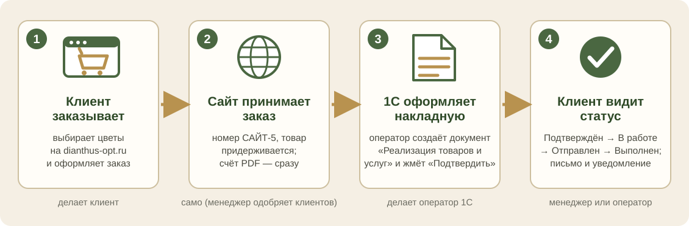
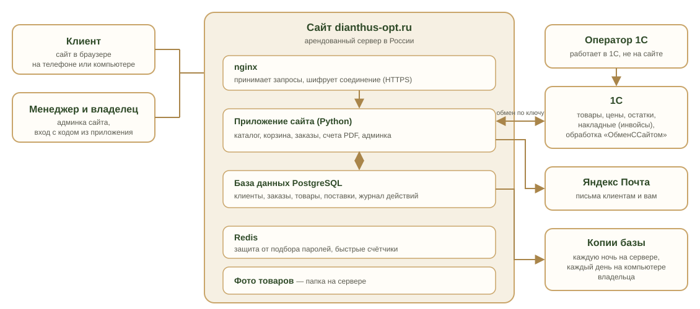

# Как работает сайт «Диантус»

Простыми словами, для владельца, менеджеров и тех, кому нужно объяснить, что это за сайт. Редакция 12.11.2026.

# Часть 1. Что это и зачем

## Сайт в двух предложениях

**dianthus-opt.ru** — закрытый оптовый магазин цветов: цены и заказ доступны только юридическим лицам и ИП после проверки менеджером. Остатки, цены и поставки приходят из 1С, заказы уходят в 1С, а покупатель видит свежие данные и сам оформляет заказ.

## Кто что видит

| Кто | Что делает на сайте |
|---|---|
| **Гость** (любой посетитель) | видит витрину без цен: каталог с фильтрами и поиском, «Как заказать», «Сроки заказа», контакты, юридические тексты; может подать заявку «Стать оптовиком» |
| **Клиент** (после одобрения) | видит свои цены со скидкой, кладёт в корзину, оформляет заказ, смотрит «Мои заказы» и статусы, скачивает счёт PDF, повторяет заказ, делает предзаказ, пишет рекламацию, управляет данными и согласиями в «Профиле» |
| **Менеджер** | одобряет или отклоняет заявки, ставит скидку, подтверждает заказы и меняет статусы, печатает лист сборки, отвечает на рекламации |
| **Владелец** (администратор) | всё то же плюс поставки, товары, настройки магазина, интеграция с 1С, юридические тексты, журнал действий; вход с кодом из приложения |
| **Оператор 1С** | работает в 1С, а не на сайте: загружает поставки и фото, переносит заказы в учёт |

## Как заказ идёт от клиента до склада и обратно

## Из чего состоит сайт

# Часть 2. Путь клиента

## Семь шагов

1. **Регистрация.** Клиент заполняет форму: компания, ИНН, ФИО, телефон, почта, город, пароль. Ставит три обязательные отметки (согласие на обработку данных, «ознакомился с политикой», «принимаю условия и оферту») и по желанию четвёртую (согласие на рекламу). Сайт запоминает согласие: кто, когда, на какую версию текста, с какого адреса.
2. **Проверка заявки.** Заявка попадает к менеджеру (плитка «заявок клиентов — одобрить»). Менеджер проверяет название, ИНН и телефон, при необходимости ставит скидку и нажимает «Одобрить». С этого момента клиенту видны цены.
3. **Каталог.** Два вида: «Карточки» и «Прайс». Фильтры: наличие (в наличии, много, средне, мало), вид, цвет, рост, страна. Поиск по названию, артикулу, штрихкоду. Цена указана **за одну штуку** и уже со скидкой клиента. Товар продаётся **упаковками** (в упаковке 10–25 штук). У позиции видны остаток и привоз («привоз 6 ноября»).
4. **Корзина и оформление.** Клиент выбирает количество упаковок (у товара может быть минимум), дату, к которой нужны цветы, самовывоз или доставку, пишет комментарий и нажимает «Подтвердить заказ». Товар сразу резервируется: остаток на сайте уменьшается.
5. **Заказ.** Статус «Новый». Счёт в PDF формируется сам. Клиент видит заказ в «Мои заказы», может скачать счёт и нажать «Повторить».
6. **Обработка.** Менеджер подтверждает заказ. Оператор 1С оформляет документ в 1С (заказ там называется «САЙТ-5», где 5 — номер на сайте), номер документа 1С возвращается на сайт. Менеджер ведёт статусы: Подтверждён → В работе → Отправлен → Выполнен. Если заказ отменить, товар возвращается на склад.
7. **Уведомления.** О каждом статусе клиент получает уведомление на сайте (колокольчик) и письмо (когда настроена почта).

## Что ещё умеет сайт для клиента

* **Предзаказ.** Если машина с цветами ещё в пути, на сайте есть раздел «Товары в пути»: клиент может заказать заранее.
* **Сроки заказа.** Страница показывает, за сколько дней нужно заказывать к нужной дате для каждой страны.
* **Рекламации.** Клиент пишет, что не так с товаром (с описанием); менеджер видит плитку «рекламаций в работе».
* **Профиль.** Данные организации, согласия (можно отозвать), скачать свои данные, запрос на удаление данных (виден владельцу, ответ в срок до 10 рабочих дней).

# Часть 3. Откуда берутся товары, цены и остатки

## 1С главная, сайт витрина

Учёт ведётся в 1С. Сайт показывает то, что 1С ему отправила, и принимает заказы.

* **Поставки.** В 1С прихода товара — документы «Инвойс» (в меню «Инвойсы» четыре списка: эквадор, голландия, горшечные, аксессуары). Каждая строка инвойса становится карточкой на сайте: название, вид (роза, хризантема, гвоздика…), длина стебля, страна, размер пачки, цена за штуку, остаток.
* **«В пути» и «в наличии».** Инвойс не проведён или с датой в будущем: товар «в пути» (клиенты могут сделать предзаказ). Проведён: товар в наличии.
* **Страна.** Берётся по папке («группе») товара в 1С: «Срезанные цветы → КЕНИЯ → …».
* **Остаток.** Сайт показывает остаток склада «Главный», распределённый по поставкам от новых к старым. Поэтому у одного товара может быть несколько карточек-«привозов» с разной датой.
* **Фото.** Файлы с названием товара в папке на компьютере 1С; пункт «3. ФОТО» отправляет их на сайт.

## Как 1С разговаривает с сайтом

* На компьютере 1С лежит файл **«ОбменССайтом»**. Его открывают в 1С: «Файл → Открыть». Меню из пяти пунктов: «1. ПОСТАВКА», «2. ЗАКАЗЫ С САЙТА», «3. ФОТО», «4. ПРОВЕРКА», «5. ДОПОЛНИТЕЛЬНО».
* 1С входит на сайт по **ключу** (длинный пароль вида `dnt_…`). Ключ создаётся на сайте в «Админка → Ещё → Интеграция с 1С» и в любой момент отзывается.
* Перед отправкой оператор видит отчёт и отвечает «Да» или «Нет»: ничего не уходит само.
* **Сейчас** оператор отправляет поставки вручную при приходе машины. **Будет:** 1С сама раз в 30 минут (когда администратор 1С создаст пользователя «Обмен», см. «План до 100%», шаг 18).
* Все обмены записываются в «Журнал».

## Заказы обратно в 1С

Оператор: «2. ЗАКАЗЫ С САЙТА» → «Показать» → оформляет документ «Реализация товаров и услуг» (в комментарии «САЙТ-5») → «Подтвердить на сайте». Номер документа возвращается на сайт, и менеджер с клиентом видят его у заказа. Автозаказы (когда 1С сама создаёт накладные) написаны и проверяются на копии базы.

# Часть 4. Админка

Кнопка **«Админка»** в меню сайта (для менеджера и владельца). Наверху блок **«Что сделать сегодня»**: плитки только с тем, что ждёт вас. Если дел нет, написано «На сегодня всё сделано».

| Вкладка | Что там |
|---|---|
| **Заказы** | список заказов, у каждого кнопка следующего шага («Подтвердить», «В работу», «Отправлен», «Выполнен»), счёт PDF, лист сборки, выгрузка в Excel |
| **Клиенты** | заявки (одобрить, отклонить), скидка, карточка клиента, поиск |
| **Товары** | каталог: правка карточек, загрузка фото |
| **Поставки** | инвойсы, пришедшие из 1С |
| **В наличии** | остатки |
| **Ещё** | рекламации; фильтры каталога (порядок видов, цветов, стран); интеграция с 1С (ключи, журнал обмена); юридические тексты и список дел; настройки магазина (реквизиты, почта для обращений, кто обрабатывает данные); журнал действий сотрудников |

# Часть 5. Безопасность и данные

* **Защищённое соединение** (HTTPS) на всех страницах.
* **Пароли** хранятся только в виде необратимого хэша: даже владелец сервера их не видит.
* **Вход администратора с кодом из приложения** (двухфакторная защита): включается в «Профиле».
* **Ограничение попыток входа** и блокировка подбора пароля; защита форм от подделки запросов.
* **Роли:** клиент, менеджер, администратор: каждый видит только своё.
* **Журнал действий** сотрудников и обмена с 1С.
* **Только юрлица и ИП**, данные хранятся на сервере в России.
* **Резервные копии:** каждую ночь в 03:15 на сервере (хранятся 14 дней) и каждый день в 13:00 на компьютере владельца (папка `D:\Dianthus\5-backups\site`, последние 60 копий). Из копии базу можно восстановить.
* **Согласия и журнал согласий**, запрос на удаление данных, версии юридических текстов.

# Часть 6. Где живёт сайт

* **Сервер.** Арендованный сервер в России. На нём работают программы: nginx (принимает запросы и шифрует соединение), приложение сайта (на языке Python), база данных PostgreSQL, Redis (защита и быстрые счётчики), certbot (сам продлевает сертификат HTTPS).
* **Исходный код.** На GitHub (Kirill010/dianthus): там хранится вся история изменений. Репозиторий открытый, поэтому в нём **нет** паролей и ключей: они лежат только на сервере.
* **Как выкладываются изменения.** Сначала автоматические проверки (сейчас 640 тестов), затем GitHub, затем сервер: скрипт обновления сам делает копию базы, обновляет сайт и проверяет, что он «здоров». Если проверка не прошла, сайт остаётся на прежней версии.
* **Что нужно оплачивать.** Аренду сервера и домен. Если не продлить, сайт перестанет открываться (см. «План до 100%», шаг 23).

# Часть 7. Чего сайт не делает

* **Нет онлайн-оплаты.** Оплата по счёту (безналом): кассовый аппарат не нужен.
* **Не ведёт учёт и склад.** Это делает 1С. Сайт показывает данные 1С и передаёт ей заказы.
* **Не отправляет письма, пока не настроена почта.** На 12.11.2026 письма отключены; уведомления есть на сайте. Настройка: «План до 100%», шаг 3.
* **Не продаёт физическим лицам.**
* **Не рассылает рекламу без согласия клиента.**
* **Не подтверждает заказы сам:** заявки клиентов и заказы подтверждают люди.

# Часть 8. Если что-то не работает

| Что случилось | Что проверить | Кому написать |
|---|---|---|
| Сайт не открывается | откройте с телефона по мобильному интернету: иногда не открывается только на одном компьютере | если и там не открывается: мне (проверю сервер, домен, оплату) |
| Клиент не может войти | одобрена ли его заявка (вкладка «Клиенты»); пароль можно восстановить кнопкой «Забыли пароль» (когда настроена почта) | менеджеру или мне |
| Остатки не совпадают с 1С | в 1С «ОбменССайтом → 4. ПРОВЕРКА»; когда была последняя отправка поставок | оператору 1С |
| Заказ не виден в 1С | «2. ЗАКАЗЫ С САЙТА → Показать» | оператору 1С |
| У товара нет фото | название файла должно совпадать с названием товара в 1С; отчёт «3. ФОТО» покажет, какие не нашлись | складу и оператору 1С |
| Письма не приходят | почта для писем ещё не настроена | мне: «План до 100%», шаг 3 |
| Браузер пишет «небезопасно» | это сертификат HTTPS: он обычно продлевается сам | сразу мне |

# Слова, которые встретятся

| Слово | Что это |
|---|---|
| **Инвойс** | документ в 1С о приходе товара; для сайта «поставка» |
| **Привоз** | дата, с которой партия на складе |
| **Упаковка (пачка)** | единица продажи: 10–25 штук одного цветка |
| **Ключ** | длинный пароль, по которому 1С входит на сайт |
| **Админка** | служебные страницы сайта для менеджера и владельца |
| **2FA** | вход с паролем и кодом из приложения на телефоне |
| **Оператор персональных данных** | организация, которая собирает данные людей; по закону несёт за них ответственность |
