# Диантус: сайт и 1С

Руководство для владельца, менеджера и оператора 1С. Редакция 12.11.2026. Читать подряд не нужно: найдите свою задачу в содержании и откройте её страницу.

# Часть 0. Главное за три минуты

## Как это всё устроено

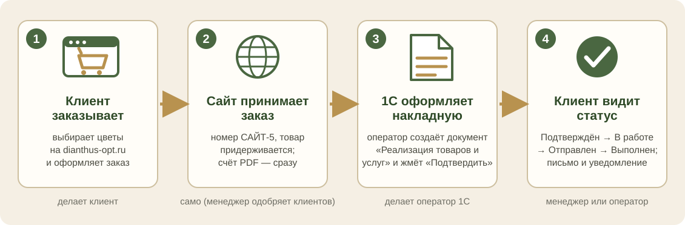

У вас два «места», где живут данные:

* **1С** — товар, цены, остатки, накладные. Здесь работает оператор 1С.
* **Сайт dianthus-opt.ru** — витрина для клиентов и их заказы. Здесь работают менеджер и владелец.

Между собой они «разговаривают» сами. Людям остаётся четыре дела:

| Кто | Что делает | Где |
|---|---|---|
| **Клиент** | выбирает цветы и оформляет заказ | на сайте dianthus-opt.ru |
| **Менеджер** | одобряет новых клиентов, смотрит заказы, меняет статус заказа | на сайте: зелёная кнопка «Админка» в меню (на телефоне — значок-шестерёнка) |
| **Оператор 1С** | загружает на сайт поставки и фото, переносит заказы в 1С | в 1С: «Файл → Открыть → ОбменССайтом» |
| **Владелец** | раз в день смотрит «Что сделать сегодня», решает про юриста, фото и почту | на сайте и в части 3 этого руководства |

> **Совет.** Дальше всё разложено по «карточкам»: одна задача на одной странице, 4–7 шагов. Запутались — вернитесь на эту страницу.

## Слова, которые встретятся

| Слово | Что это |
|---|---|
| **Инвойс** | документ в 1С о приходе товара. Для сайта инвойс — это «поставка» |
| **В наличии / в пути** | в наличии: инвойс проведён, товар на складе. В пути: инвойс не проведён, клиенты могут сделать предзаказ |
| **Обработка «ОбменССайтом»** | файл `ОбменССайтом.epf` на рабочем столе компьютера 1С. Открывается в 1С и показывает меню из пяти пунктов |
| **Ключ** | длинный пароль вида `dnt_…`, по которому 1С входит на сайт. Вводится один раз, клиентам не нужен |
| **Админка** | служебные страницы сайта для менеджера и владельца |
| **САЙТ-5** | так заказ № 5 с сайта называется в 1С |
| **Статус заказа** | Новый → Подтверждён → В работе → Отправлен → Выполнен (или Отменён) |

# Часть 1. Оператор 1С

## 1. Как открыть обмен с сайтом

Это нужно каждый раз, когда вы хотите загрузить поставку, фото или посмотреть заказы.

1. В 1С нажмите меню **«Файл»**, затем **«Открыть…»** (или сочетание клавиш Ctrl+O).

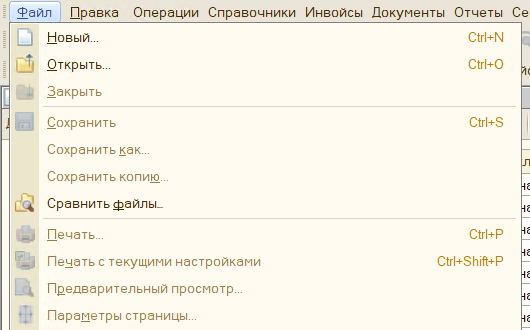

2. В окне найдите файл **«ОбменССайтом»** (он лежит на рабочем столе) и нажмите **«Открыть»**.

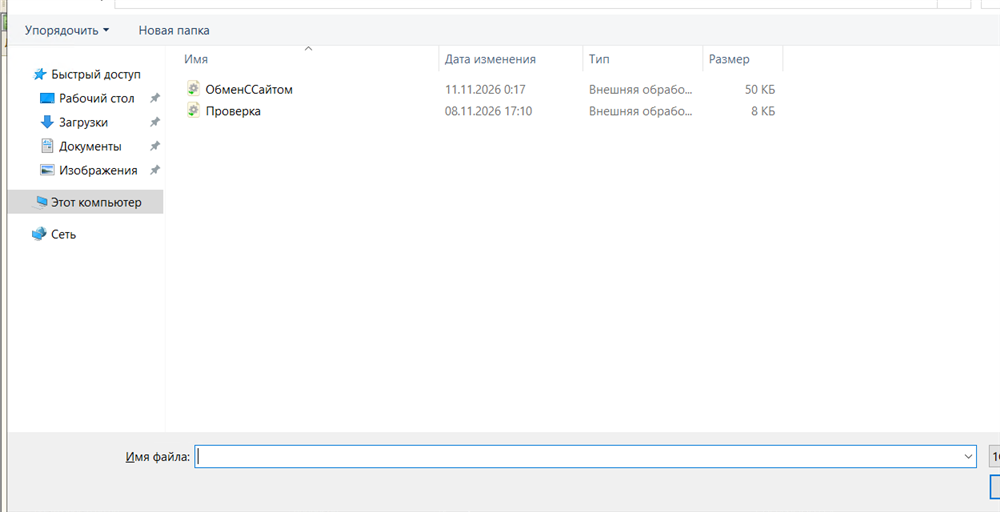

3. 1С спросит «Разрешить открывать данный файл?». Нажмите **«Да»**: файл наш, он безопасен.
4. Появится меню из пяти пунктов. Выберите нужный и нажмите **«OK»**. Чтобы выйти, нажмите **«Отмена»**.

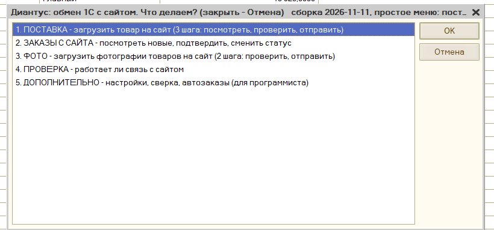

Пункт **«5. ДОПОЛНИТЕЛЬНО»** нужен программисту (настройки, сверка, автозаказы). Оператору в нём делать нечего.

> **Важно.** Окно с отчётом закрывается кнопкой **«OK»** (мышкой). Клавиша Enter в нём только добавляет пустую строку. Любой отчёт сохраняется в файл `Документы\Dianthus1C\last_report.txt`.

> **Если что-то не так.** Видите длинный список из 21 пункта, а первой строкой «Первая настройка»? Это старая версия меню, она осталась в памяти 1С. Нажмите **«Отмена»**, закройте 1С и откройте её заново. Пункт «Первая настройка» **не нажимайте**. В заголовке нового меню написано «сборка 2026-11-11, простое меню».

## 2. Пришла поставка: загрузить товар на сайт

Делайте это каждый раз, когда пришла машина или изменились остатки и цены. Мастер сам ведёт по трём шагам и **ничего не отправит без вашего «Да»**.

1. Оформите приход в 1С инвойсом, как всегда. Проведён — товар «в наличии». Не проведён — «в пути».
2. Откройте обмен (карточка 1), выберите **«1. ПОСТАВКА»**, нажмите **«OK»**.
3. **Шаг 1 из 3 — посмотреть.** Появится отчёт: что именно уйдёт на сайт. Прочитайте строки со словом «ПРОВЕРЬТЕ» (там программа сама угадала размер пачки). Закройте окно кнопкой **«OK»**.

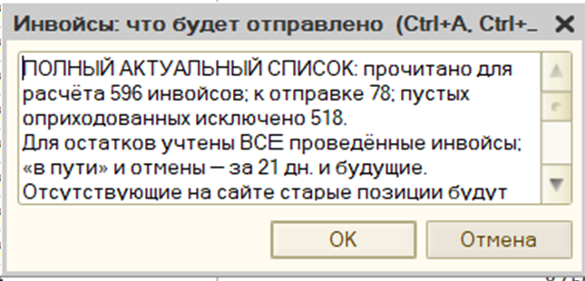

4. Мастер спросит, проверить ли это на сайте. Если всё верно, нажмите **«Да»**.

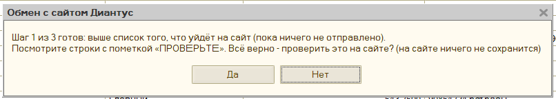

5. **Шаг 2 из 3 — проверка на сайте.** Сайт ничего не сохраняет, он только проверяет. Смотрите первую строку: «ИТОГ: проверка прошла, ошибок нет. Можно отправлять.» Если там «НЕ ГОТОВО», мастер сам остановится, дальше не идите: прочитайте ошибки ниже и исправьте данные в 1С.

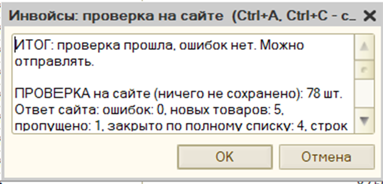

6. **Шаг 3 из 3 — отправка.** Мастер спросит: «Отправить на сайт N инвойсов ПО-НАСТОЯЩЕМУ?». Нажмите **«Да»** только если уверены.

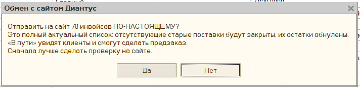

7. Готово. Первая строка отчёта: «ИТОГ: поставка отправлена на сайт, ошибок нет». Откройте каталог на сайте и убедитесь, что товар появился.

> **Важно.** Сайт всегда получает **полный** список поставок. Чего в списке нет, то на сайте закрывается, остатки обнуляются. Поэтому не прерывайте мастер на середине и не отправляйте «куски».

## 3. Заказ с сайта: от заказа до накладной

Сейчас заказы переносятся в 1С руками (оператор оформляет документ так же, как по звонку клиента). Когда автозаказы будут проверены на копии базы, накладная начнёт создаваться сама. Путь документа один и тот же: **Документы → Реализации товаров и услуг**.

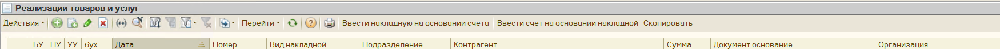

1. Откройте обмен, выберите **«2. ЗАКАЗЫ С САЙТА»**, затем **«1. Показать новые заказы с сайта»**. Отчёт покажет номер заказа (САЙТ-5), клиента с ИНН, товары, штуки и цены.

```
=== ЗАКАЗ САЙТ-2 от 11.11.2026; нужен к 16.11.2026
    Клиент: ООО «Тестовый Цветочек», ИНН 5001001239, +7 (900) 111-22-33
    Получение: доставка, Москва, ул. Цветочная, 1
    Скидка клиента: 5.0%;  итого по заказу: 3610 ₽
      - Эвкалипт Цинерея: 10 шт (по 10 в уп.) x 70 ₽ = 700 ₽
      - Пион Sarah Bernhardt: 10 шт (по 10 в уп.) x 310 ₽ = 3100 ₽
```

2. Создайте документ в 1С так же, как обычно: «Счёт на оплату», затем «Расходная накладная». В комментарии напишите **САЙТ-5** (номер заказа), чтобы не создать документ дважды. Зарезервируйте товар.
3. Вернитесь в обмен: **«2. ЗАКАЗЫ С САЙТА»** → **«2. Заказ оформлен в 1С … подтвердить на сайте»**. На вопрос «Документ создан в 1С и товар зарезервирован?» нажмите **«Да»** только если это так. Впишите номер документа (например, д-001812) и нажмите **«OK»**. Заказ перестанет появляться в списке новых.

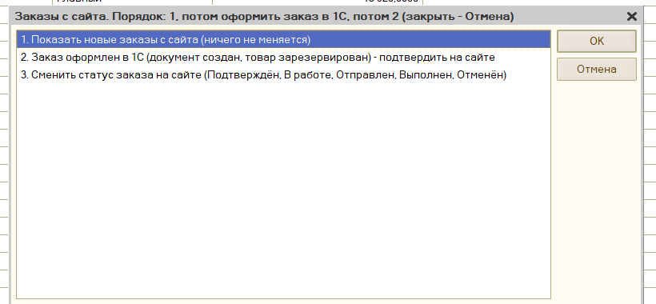

4. Статус заказа на сайте ставит менеджер (карточка 7) либо вы: **«3. Сменить статус заказа на сайте»**.

> **Важно.** Нажимайте «Да» на вопросе о подтверждении **только после** того, как документ создан и товар зарезервирован. Если ответить «Нет», заказ останется новым и появится снова.

## 4. Фото товаров на сайт

Сейчас на сайте вместо фото значки: фото нет ни у одной позиции. Начните с 30 самых ходовых товаров.

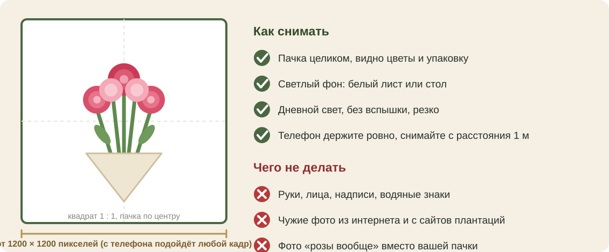

| Что | Как правильно |
|---|---|
| **Формат файла** | JPG (так снимает телефон). Подойдут и PNG, и WEBP. Переводить ничего не нужно |
| **Размер кадра** | от 1200 × 1200 пикселей. Больше 1600 сайт сам уменьшит. Больше 40 мегапикселей сайт не примет |
| **Вес файла** | до 15 МБ через 1С (до 5 МБ, если загружаете через админку сайта) |
| **Форма кадра** | квадрат 1 : 1, пачка по центру. В каталоге карточка квадратная, края обрезаются |
| **Свет и фон** | дневной свет, белый лист или стол, без вспышки |
| **Сколько фото** | до 10 на один товар. Первое — главное |
| **Имя файла** | **ровно как название товара в 1С**: `Мондиал 60 Tessa.jpg`. Регистр букв, «ё» и лишние пробелы не важны |
| **Второе, третье фото** | `Мондиал 60 Tessa #2.jpg`, `Мондиал 60 Tessa #3.jpg` |

1. Сфотографируйте пачку. Назовите файл как товар в 1С.
2. Положите файлы в папку `Документы\Dianthus1C\photos` на компьютере 1С.
3. Откройте обмен, выберите **«3. ФОТО»**, нажмите **«OK»**. Мастер сначала проверяет все фото. Если в папке пусто или файл не нашёл свой товар, он остановится и объяснит почему.
4. Если проверка прошла (первая строка отчёта: «ИТОГ: проверка прошла…»), мастер спросит, отправлять ли фото. Нажмите **«Да»**.
5. Откройте товар на сайте и посмотрите, что фото на месте. Повторная отправка того же файла ничего не дублирует.

> **Важно.** Только свои фото или фото, которые поставщик разрешил вам письменно. Чужие снимки с сайтов и из поиска ставить нельзя: за это штрафуют (ст. 1301 ГК, от 10 тысяч до 5 миллионов рублей).

## 5. Если что-то пошло не так (оператору)

| Что видите | Что делать |
|---|---|
| Меню из 21 пункта, первой строкой «Первая настройка» | Это старая версия в памяти 1С. «Отмена», закройте 1С, откройте заново. «Первая настройка» не нажимайте |
| «ПРОБЛЕМА: сайт не отвечает с этого компьютера» | Проверьте интернет. Подождите минуту и снова выберите **«4. ПРОВЕРКА»**. Не помогло — сообщите программисту |
| «ПРОБЛЕМА: сайт отвечает, но ключ не принят» | Сообщите владельцу: нужен новый ключ (админка сайта → «Интеграция с 1С») |
| «ИТОГ: НЕ ГОТОВО» после проверки поставки | Ничего не отправляйте. Прочитайте строки ниже: чаще всего не заполнена цена, пачка или страна товара. Исправьте в 1С и начните «Поставка» заново |
| Мастер «Фото» остановился | В папке нет фото или имя файла не совпало с товаром. Исправьте имя и начните заново |
| Окно отчёта не закрывается | Нажмите кнопку **«OK»** мышкой, Enter не работает |
| Закрыли отчёт, не дочитав | Он сохранён в `Документы\Dianthus1C\last_report.txt` |
| Нажали «Нет» не на том вопросе | Ничего не отправлено. Просто начните сначала |

Проверка «работает ли связь» — это пункт **«4. ПРОВЕРКА»**. Если всё хорошо, первая строка такая:

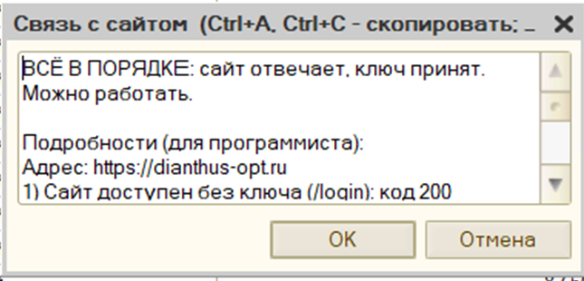

# Часть 2. Менеджер

## 6. Новый клиент: одобрить и дать скидку

1. Откройте dianthus-opt.ru и нажмите **«Войти»**. Если у администратора включена двухфакторная защита (рекомендуем, карточка 10), после пароля нужен ещё код из приложения (Яндекс.Ключ или Google Authenticator).
2. Нажмите зелёную кнопку **«Админка»** в меню сверху (на телефоне — значок **шестерёнки**). Вверху блок **«Что сделать сегодня»**: на плитках только то, что ждёт вас. Дел нет — написано «На сегодня всё сделано».

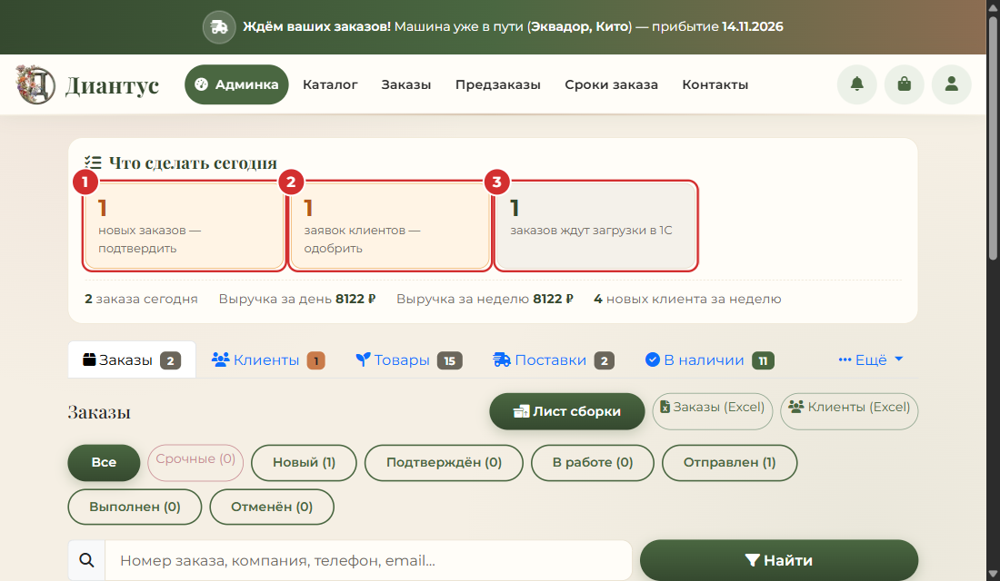

3. Нажмите плитку **«заявок клиентов — одобрить»**. Откроется вкладка **«Клиенты»**.
4. В строке нового клиента проверьте название, ИНН и телефон. Сомневаетесь — позвоните.
5. Нужна скидка? Впишите проценты в поле со знаком «%» рядом с кнопкой «Одобрить» и нажмите Enter. Сверху появится зелёная плашка «скидка 5.0%».
6. Нажмите **«Одобрить»**. Клиент увидит цены и сможет заказывать. Кнопка **«Отклонить»** — отказ.

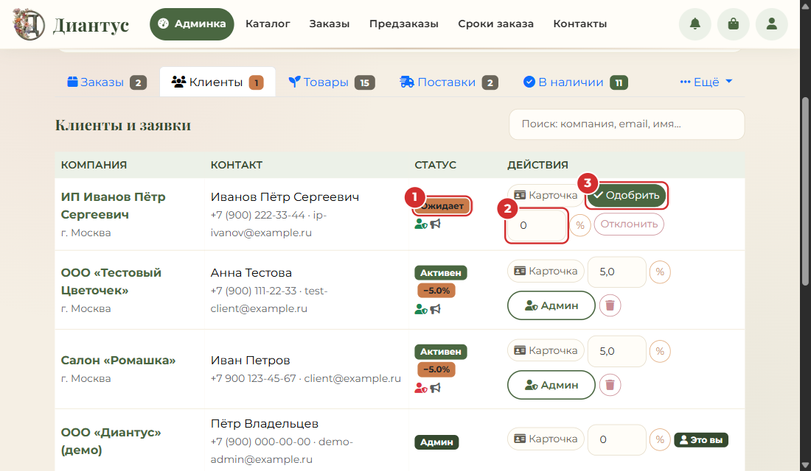

> **Важно.** Скидка и «Одобрить» — две отдельные кнопки: сначала впишите скидку и нажмите Enter, потом «Одобрить».

## 7. Заказ клиента: что делать и какой статус ставить

Клиент видит свой заказ сразу, в разделе «Мои заказы», со статусом «Новый». Счёт в PDF формируется сам.

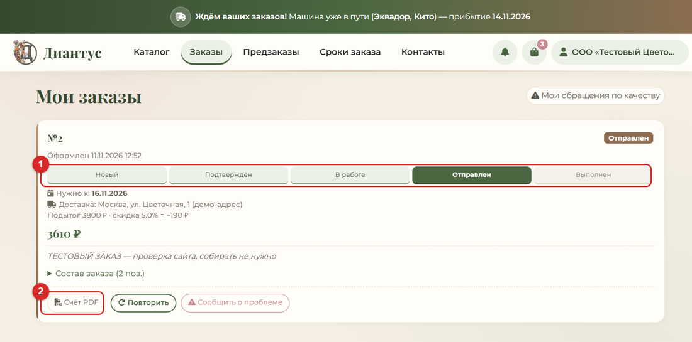

1. Новый заказ появляется в плитке **«новых заказов — подтвердить»** (админка, вкладка «Заказы»). Откройте его.
2. Прочитайте, что просит клиент: когда нужны цветы, самовывоз или доставка, комментарий.
3. Если нужно, свяжитесь с клиентом. Кнопка **«Счёт PDF»** — счёт готов, клиент тоже может скачать его у себя.
4. Передайте заказ оператору 1С (карточка 3). Он оформит документ и впишет номер документа 1С: вы увидите его вверху заказа.
5. Меняйте статус в выпадающем списке и нажимайте **«Сохранить»**. Клиент получает уведомление на сайте и письмо.
6. Быстрее: в списке заказов (вкладка «Заказы») у каждого заказа есть кнопка следующего шага — **«Подтвердить»**, **«В работу»**, **«Отправлен»**, **«Выполнен»**. Одно нажатие — статус сменился. Другой статус, например «Отменён», — по кнопке **«⋯»** рядом.

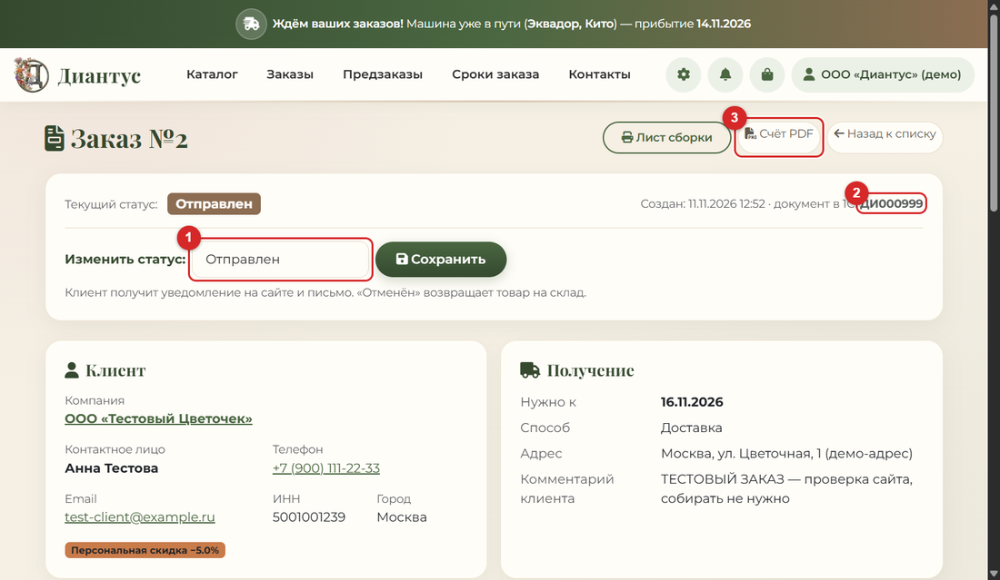

| Статус | Когда ставить |
|---|---|
| **Новый** | заказ только что пришёл |
| **Подтверждён** | вы поговорили с клиентом, документ в 1С создан, товар зарезервирован |
| **В работе** | заказ собирают |
| **Отправлен** | заказ отправлен или клиент забрал |
| **Выполнен** | заказ получен, вопросов нет |
| **Отменён** | клиент отказался или нет товара. Товар **вернётся на склад** |

# Часть 3. Владелец

## 8. Каждый день за две минуты

1. Откройте сайт, кнопка «Админка». Если в «Что сделать сегодня» написано «На сегодня всё сделано», делать нечего. Плитки — это задачи.
2. В 1С раз в день выберите **«4. ПРОВЕРКА»**. Нужна первая строка «ВСЁ В ПОРЯДКЕ: сайт отвечает, ключ принят».
3. Раз в неделю откройте папку `D:\Dianthus\5-backups\site` и убедитесь, что там есть свежий файл `db-…` (копия базы сайта).
4. Если сайт не открывается: откройте его с телефона по мобильному интернету. Иногда сайт не открывается только с одного компьютера. Не открывается и там — сообщите программисту.

> **Совет.** Ничего не ломается от того, что вы смотрите. Кнопки «показать», «проверка» и «ПРОВЕРКА» ничего не меняют ни на сайте, ни в 1С.

## 9. Что осталось до «100 из 100»

«100 из 100» по приборам Google (скорость, доступность, поиск) сайт уже набрал на всех главных страницах. Оставшиеся баллы — это **дела людей**. Ниже весь список, по порядку важности. Подробно, по шагам, с готовыми текстами: документ **«План до 100%»** (файл Word в папке `D:\Dianthus\3-documents\Для владельца`), а также «Юрист и Роскомнадзор: пошагово», «SEO пошагово» и «Как работает сайт».

| № | Что сделать | Кто | Готово, когда |
|---|---|---|---|
| 1 | Создать почту **dianthus-opt@ya.ru** (карточка 10) | вы, **сделано**; осталось заменить номер телефона у ящика на рабочий | вы вошли в ящик и получили письмо |
| 2 | Сменить логин администратора на эту почту | я, **сделано** 11.11.2026 | вы вошли на сайт по новой почте со старым паролем |
| 3 | Яндекс Вебмастер и Метрика (карточка 11) | вы | у вас есть номер счётчика, вы мне его прислали |
| 4 | Включить Метрику на сайте и дописать политику | я, после п. 3 | на сайте появился баннер «Согласен / Отказаться» |
| 5 | Яндекс Бизнес и 2ГИС (карточка 11) | вы | организация видна на картах |
| 6 | Показать тексты юристу и подать уведомление в Роскомнадзор (карточка 12) | вы и юрист | в «Юридическое» отмечено «проверен юристом» и «подано» |
| 7 | Фото 30 ходовых товаров (карточка 4) | склад | фото видны у товаров на сайте |
| 8 | Решить 4 спорных товара из 12 (карточка 13) | вы | в 1С страна у них исправлена |
| 9 | Копия базы «Цветы» для проверки автозаказов (карточка 14) | администратор 1С | в списке баз 1С есть «Цветы ТЕСТ» |
| 10 | Пользователь 1С для автообмена и расписание (карточка 14) | администратор 1С | сайт каждые 30 минут сам получает остатки |
| 11 | Копия базы сайта вне сервера (карточка 15) | я, **сделано** 11.11.2026 | на вашем компьютере каждый день появляется свежая копия |
| 12 | Неделя спокойной работы | все | нет ошибок в «ПРОВЕРКА» и жалоб клиентов |

> **Совет.** Если хотите быстро поднять оценку, начните с пунктов 1 и 6 (почта и юрист), потом 7 (фото). Фото клиенты замечают больше всего.

## 10. Почта на Яндексе и смена логина администратора

Логин администратора и почта для обращений на сайте теперь рабочий адрес **dianthus-opt@ya.ru** (раньше был личный ящик на mail.ru). Создать такую почту могли только вы (я не вправе создавать учётные записи); ниже порядок, как это делалось.

1. Откройте **ya.ru** и нажмите **«Войти»**, затем **«Создать ID»**.
2. Выберите способ через **номер телефона** и подтвердите его кодом из СМС.
3. Придумайте логин **dianthus-opt** (если занят, добавьте цифру или слово). Адрес получится **dianthus-opt@ya.ru**.
4. Придумайте пароль и **запишите его в надёжное место**: без него в ящик не войти. Мне пароль не присылайте.
5. Откройте почту и отправьте себе тестовое письмо: так вы убедитесь, что ящик работает.
6. Напишите мне: «почта готова». Дальше я сам (сделано 11.11.2026):
   * в «Настройки магазина → Почта для обращений клиентов» вписан новый адрес (он показывается в политике, согласиях и оферте);
   * логин администратора теперь dianthus-opt@ya.ru, пароль прежний;
   * в настройках сервера заменён адрес администратора и убран старый пароль, иначе после перезапуска сайт создал бы второго администратора со старым адресом. Перед этим сделана свежая копия базы; копия прежних настроек сервера лежит на сервере и будет удалена, когда вы подтвердите вход.

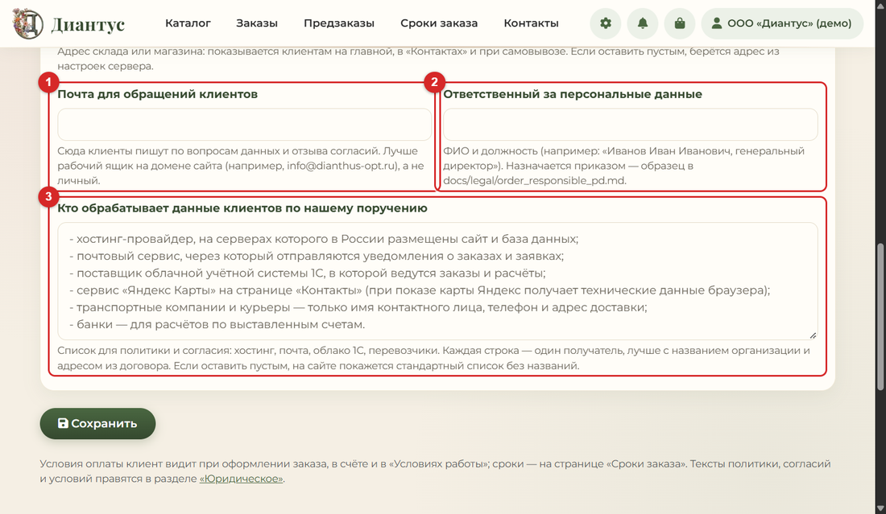

> **Важно.** Входите на сайт по новому адресу **dianthus-opt@ya.ru**, пароль прежний. Старый адрес mail.ru больше не работает как логин.
>
> **Двухфакторная защита сейчас выключена** (на сервере проверено 11.11.2026). Включите её сами: на сайте откройте «Профиль» (значок человечка справа вверху), найдите блок «Двухфакторная защита (2FA)» и нажмите «Включить 2FA». Отсканируйте QR-код приложением Яндекс.Ключ или Google Authenticator и введите код из приложения. Это две минуты, нужен только телефон. После этого при входе нужны пароль и код из приложения. Если потеряете телефон, скажите мне: я отключу защиту на сервере, и вы включите её заново.

## 11. Яндекс Вебмастер, Метрика, Яндекс Бизнес и 2ГИС

Зачем: чтобы вас находили в поиске и на картах и чтобы вы видели, сколько людей заходит на сайт. Всё это ваши личные кабинеты: создаёте вы, входите той же Яндекс-почтой.

| Что | Куда | Что понадобится |
|---|---|---|
| Яндекс Вебмастер | webmaster.yandex.ru, «Добавить сайт» | адрес `https://dianthus-opt.ru` |
| Яндекс Метрика | metrika.yandex.ru, «Добавить счётчик» | название «Диантус», адрес сайта, номер счётчика отправить мне |
| Яндекс Бизнес | business.yandex.ru, «Добавить организацию» | данные ниже |
| 2ГИС | 2gis.ru, «Добавить организацию» | те же данные |

**Данные об организации (копируйте как есть):**

| Поле | Значение |
|---|---|
| Название | Диантус, оптовая база цветов |
| Адрес | Москва, Вешняковская улица, 39Г |
| Телефон | +7 (901) 188-77-87 |
| Часы работы | ежедневно, 09:00–21:00 |
| Сайт | https://dianthus-opt.ru |
| Рубрики | цветы оптом, оптовая торговля цветами (выберите ближайшие из списка) |
| Описание | Оптовая база свежих цветов в Москве. Розы из Эквадора, Кении, Голландии и России, хризантемы, гвоздика, зелень. Работаем с юридическими лицами и ИП. Заказ на сайте, самовывоз и доставка |

1. Создайте всё по очереди: Вебмастер, Метрика, Яндекс Бизнес, 2ГИС.
2. В Вебмастере подтвердите права на сайт. Если попросит «мета-тег» или файл, пришлите мне код, я добавлю его на сайт.
3. В Метрике скопируйте **номер счётчика** (цифры) и отправьте мне.
4. Я впишу номер на сайт и дополню политику строкой про Метрику. На сайте появится баннер «Согласен / Отказаться»: счётчик загружается только после согласия посетителя.
5. Я подам карту сайта (`sitemap.xml`) в Вебмастер.
6. В Яндекс Бизнесе и 2ГИС добавьте фото склада и ответьте на отзывы: для запроса «цветы оптом Москва» это важнее, чем сам сайт.

> **Важно.** Метрику включаю только после того, как юрист посмотрит формулировку про cookie (карточка 12).

## 12. Юрист и Роскомнадзор

**Можно ли отправить юристу документы?** Да. Я собрал для него пакет: `D:\Dianthus\3-documents\Для юриста`. Откройте папку, добавьте её в архив и отправьте юристу. В пакете: письмо с вопросами, 4 текста с сайта в PDF (политика, согласие, согласие на рекламу, условия и оферта) и внутренние образцы (приказ, положение, обязательство сотрудников, пункт для договоров, план при утечке, черновик ответов для Роскомнадзора).

**Все ли документы есть?**

| Документ | Статус |
|---|---|
| Политика обработки персональных данных | есть на сайте (`/privacy`), ответственный указан |
| Согласие на обработку персональных данных | есть (`/consent`), отдельная галочка |
| Согласие на получение рекламы | есть (`/marketing-consent`), необязательное |
| Условия работы и оферта | есть (`/terms`) |
| Приказ об ответственном за персональные данные | образец готов, нужна подпись |
| Положение об обработке и защите данных | образец готов, нужна подпись |
| Обязательство сотрудников о неразглашении | образец готов, подписывают менеджеры |
| Пункт о поручении обработки (для договоров с хостингом, почтой, перевозчиками) | образец готов, нужно вписать в договоры |
| План действий при утечке данных | готов |
| Уведомление в Роскомнадзор | ответы для формы готовы, **не подано** |
| Список тех, кто обрабатывает данные по поручению (названия, адреса) | **не заполнен**, нужны данные из договоров |

**Что делать по порядку:**

1. Отправьте юристу пакет и попросите ответить на вопросы из письма (там 10 вопросов, главный: нужно ли вам подавать уведомление в Роскомнадзор).
2. Если юрист скажет «подавайте»: откройте **pd.rkn.gov.ru** → «Реестр операторов» → «Подать уведомление», войдите через **Госуслуги руководителя**. Ответы для каждого поля лежат в пакете (файл «Уведомление РКН: готовые ответы»). Подача бесплатная, занимает 20–30 минут. Сохраните подтверждение.
3. На сайте в «Админка → Ещё → Юридическое» нажмите **«Проверен юристом»** у каждого текста и **«Отметить»** у пунктов «Показать тексты юристу» и «Подать уведомление».
4. Впишите в «Настройки магазина» названия и адреса хостинга, почты и перевозчиков (из договоров) в поле «Кто обрабатывает данные клиентов по нашему поручению».

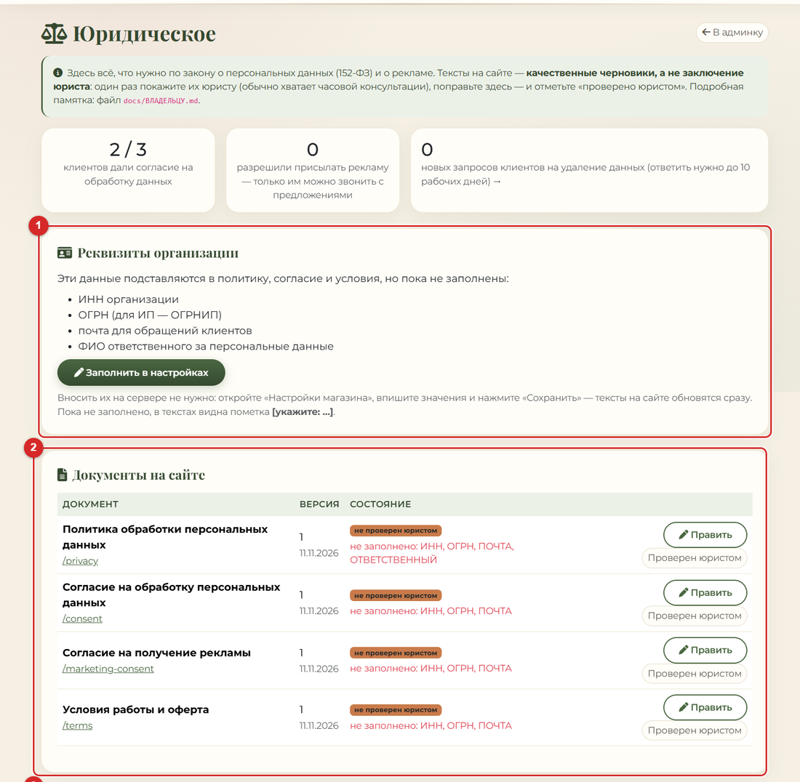

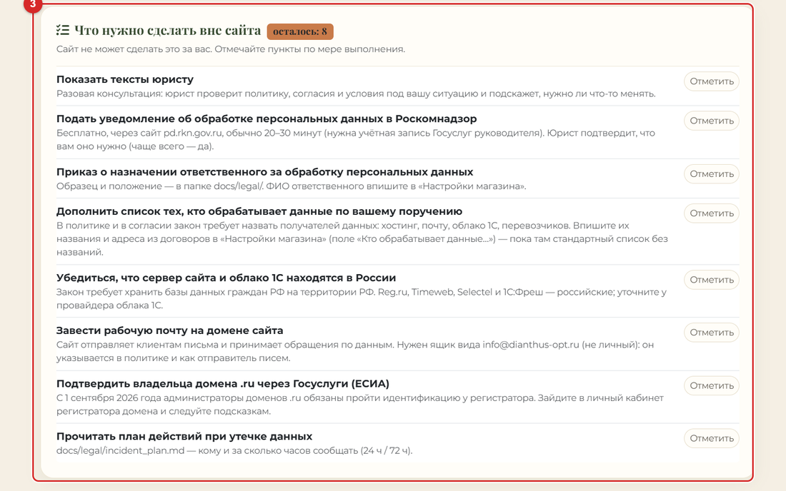

> **Важно.** Я не юрист: тексты на сайте — качественные черновики. Окончательное решение по ним и по уведомлению принимает ваш юрист.

## 13. Спорные товары: решить судьбу

**Что не так.** У каждого товара в 1С страна записана в двух местах: в **папке** («Срезанные цветы → КЕНИЯ → …») и в **карточке** (поле «Страна происхождения»). У 12 товаров они не совпадают. Сайт сейчас показывает страну **из папки** (так вы просили). Нужно решить, какая запись верна.

**Что решать вам.** Ничего ломать не нужно: сайт уже показывает страну из папки. Решение нужно, чтобы данные в 1С не противоречили сами себе.

| Товар в 1С | Папка (сайт показывает) | Карточка | Мой вывод |
|---|---|---|---|
| Аспидистра (Израиль) | Израиль | Россия | папка верна: в названии «Израиль» |
| Лизиантус микс 70 (Израиль) | Израиль | Россия | папка верна: в названии «Израиль» |
| Роза Мадам Ред 35 Кения Ultraflo | Кения | Россия | папка верна: в названии «Кения» |
| Роза микс 35 Кения Ultraflo | Кения | Россия | папка верна: в названии «Кения» |
| Роза микс 40 Madam RED Кения Ultraflo | Кения | Россия | папка верна: в названии «Кения» |
| Кустовая Birds Nest 60 GROOVE | Кения | Россия | папка верна: GROOVE — кенийская плантация |
| Кустовая Birds Nest 60 LEMOTTI | Кения | Россия | папка верна: LEMOTTI — кенийская плантация |
| Кустовая роза 60 SIAN | Кения | Россия | папка верна: SIAN — Кения (вы подтвердили) |
| **Банксия** | Голландия | Италия | **проверьте по накладной поставщика** |
| **Картамус** | Голландия | Россия | **проверьте по накладной поставщика** |
| **Статица Rosa Sun Birds** | Голландия | Италия | **проверьте по накладной поставщика** |
| **Сантини Country** | Голландия | Россия | **проверьте по накладной поставщика** |

**Где искать четыре нижних товара в 1С.** В меню **«Инвойсы» → «Инвойс голландия»**, а не в «Инвойс эквадор»: в списке «Инвойс эквадор» их нет, поэтому там не найти. Это документы «Инвойс срезка голландия» поставщика MH FLOWERS B.V.: № 00000567 от 05.10.2026 (Банксия, Картамус), № 00000592 от 11.10.2026 (Банксия), № 00000660 от 09.11.2026 (Сантини Country), № 00000661 от 09.11.2026 (Статица Rosa Sun Birds; в 1С это строка 8, цена 149,23, как на сайте). Поставщик голландский, остальные позиции этих накладных тоже голландские: скорее всего, ошибочна **карточка** товара.

1. По восьми верхним товарам ничего решать не нужно: оператор 1С может поправить поле «Страна происхождения» в карточке, чтобы она совпала с папкой.
2. По четырём нижним откройте накладную поставщика (или посмотрите этикетку на коробке): где выращено? Если верна папка, поправьте карточку. Если верна карточка, **переложите товар в папку нужной страны** в 1С.
3. После правок отправьте поставки на сайт (карточка 2) и скажите мне: я сверю сайт со всеми 253 позициями.

> **Важно.** Всего в таблице проверки 15 строк на сайте. Это 12 разных названий: один товар приходил в нескольких поставках.

## 14. Администратор 1С: копия базы и пользователь для автообмена

Эти два дела нельзя сделать без прав администратора 1С и сервера. Вам не нужно ничего настраивать самому: перешлите администратору готовые сообщения ниже.

**Зачем нужна копия базы.** Автозаказы будут сами создавать накладные в 1С. Проверять их на настоящей базе нельзя: можно испортить учёт. Поэтому нужна **копия** базы «Цветы» (в списке баз она будет называться «Цветы ТЕСТ»), на ней проверим всё без риска.

**Зачем нужен пользователь.** Чтобы 1С раз в 30 минут сама отправляла остатки на сайт, без человека. Для этого нужен отдельный пользователь 1С «Обмен», под которым запускается обмен.

**Сообщение администратору про копию (скопируйте и отправьте):**

```
Здравствуйте! Нужна копия базы «Цветы» (клиент-серверная) для проверки обмена с сайтом.
Рабочую базу трогать не надо, работу копия не остановит.

Способ А (лучший, на уровне SQL): полная резервная копия COPY_ONLY, восстановить как новую БД
с именем «…_test», создать в кластере базу «Цветы ТЕСТ» на ней.
ВАЖНО: у новой базы включить «Блокировку регламентных заданий» (иначе в копии пойдут рассылки и обмены).
Способ Б (без SQL): ночью, когда никто не работает, выгрузка .dt из Конфигуратора и загрузка в новую базу.

После создания пришлите, пожалуйста, название базы в списке запуска 1С.
```

**Сообщение администратору про пользователя (скопируйте и отправьте):**

```
Здравствуйте! Нужен пользователь 1С для обмена с сайтом: имя «Обмен», вход по логину и паролю,
роль только на чтение (справочники, цены, остатки, документы-инвойсы). Больше никаких прав.
Пароль передайте программисту отдельно, не в общем чате.
Потом нужно один раз запустить на компьютере 1С скрипт install_auto_exchange.ps1
(он создаст задачу Планировщика Windows и спросит пароль пользователя).
```

> **Важно.** Пароль пользователя «Обмен» я не вправе вводить за вас. Его вводит администратор в окне скрипта. Я проверю журнал задачи и работу обмена.

## 15. Копия базы сайта вне сервера

Сайт каждую ночь в 03:15 делает копию базы на **своём же сервере**. Если сервер сломается или пропадёт, пропадут и копии. Поэтому копия нужна ещё и **у вас на компьютере**.

**Что сделано.** Скрипт `scripts\pull_backup.ps1` по SSH просит сервер сделать свежую копию, скачивает её (база и фото), проверяет, что файлы целые, и кладёт в папку `D:\Dianthus\5-backups\site`. Хранит последние 60 файлов. Первая копия уже лежит в этой папке.

**Ежедневный запуск включён (11.11.2026).** В Планировщике Windows есть задача «Dianthus - копия базы сайта вне сервера»: каждый день в 13:00 под вашей учётной записью. Запуск из Планировщика проверен, прошёл успешно.

1. Если компьютер в 13:00 был выключен, копия сделается при ближайшем включении.
2. Журнал: `D:\Dianthus\5-backups\site\pull_backup.log`. Файл `latest.txt` показывает время последней удачной копии.
3. Копия содержит данные клиентов: храните папку только у себя, никому не пересылайте.
4. Если задачу когда-нибудь удалят, создайте её заново одной командой в PowerShell:

```
powershell -NoProfile -ExecutionPolicy Bypass -File D:\Dianthus\1-site\scripts\install_pull_backup.ps1
```

> **Совет.** Лучше ещё раз в месяц копировать эту папку на флешку или в облако: тогда сохранится и при поломке компьютера.

# Часть 4. Покупателю

## 16. Заказ на сайте за пять шагов

Это то, что видит ваш клиент. Те же шаги написаны на странице «Как заказать» на самом сайте.

1. **Регистрация и вход.** Нажмите «Стать оптовиком», заполните форму и поставьте три обязательные галочки. Менеджер проверит заявку (обычно в течение рабочего дня). Потом входите по почте и паролю. Значок «глаз» справа от поля показывает пароль, чтобы не ошибиться.

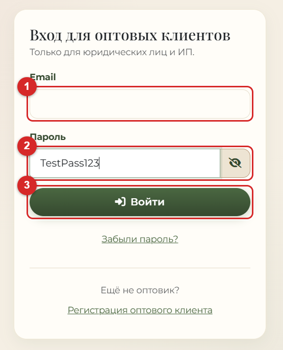

2. **Каталог.** Выберите цветы. Цена указана за одну штуку и уже со **скидкой клиента**. Кнопка «+» кладёт в корзину одну упаковку.

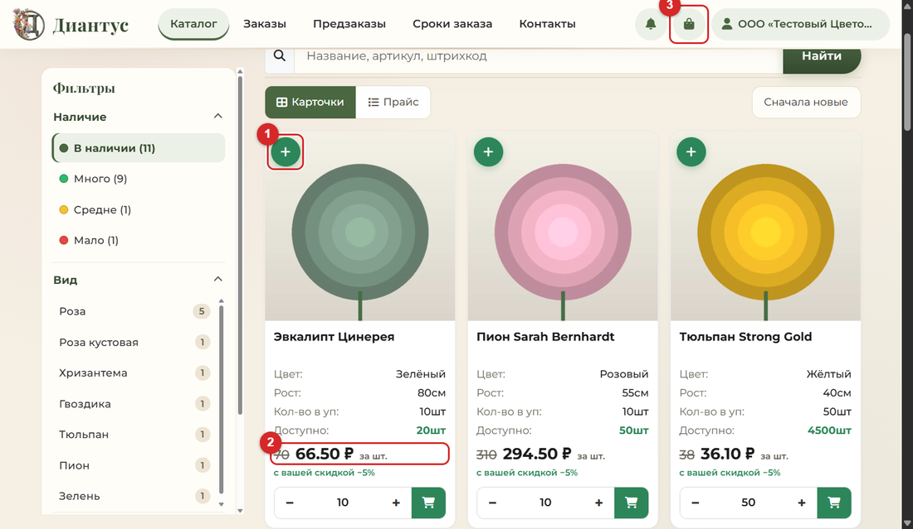

3. **Корзина.** Проверьте количество упаковок и итог. Нажмите «Оформить».

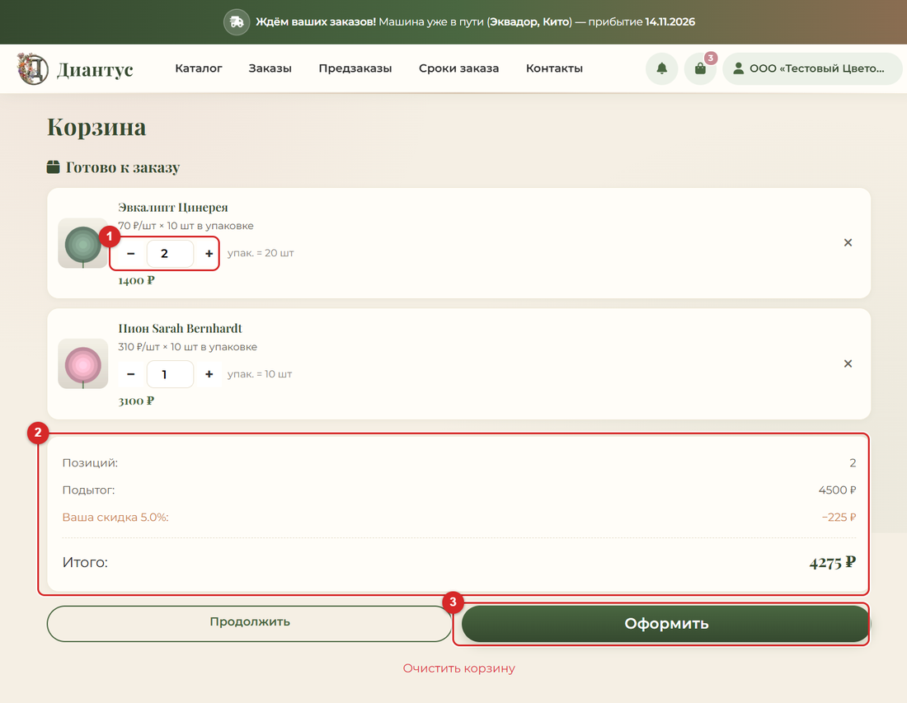

4. **Оформление.** Укажите, к какой дате нужны цветы, самовывоз или доставка. Нажмите «Подтвердить заказ».

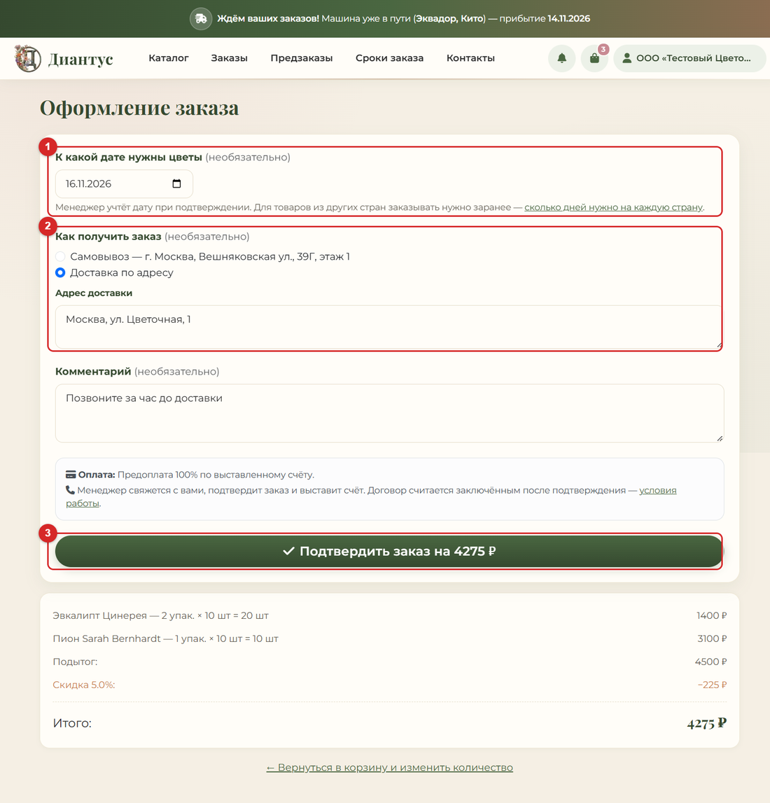

5. **Мои заказы.** Здесь статус заказа, счёт в PDF и кнопка «Повторить». О каждом новом статусе придёт письмо и уведомление.

# Приложение

## Где что лежит на компьютере

| Что | Где |
|---|---|
| Этот документ (PDF) | `D:\Dianthus\3-documents\Руководство Диантус (11.11.2026).pdf` |
| Пакет для юриста (PDF и Word, можно править) | `D:\Dianthus\3-documents\Для юриста` |
| План до 100%, «Юрист и Роскомнадзор», «SEO», «Как работает сайт», книга «Обмен 1С и сайта» (Word и PDF) | `D:\Dianthus\3-documents\Для владельца` |
| Копии базы сайта | `D:\Dianthus\5-backups\site` |
| Исходники сайта (GitHub: Kirill010/dianthus) | `D:\Dianthus\1-site` |
| Файл обработки для 1С | `D:\Dianthus\1-site\docs\1c_kit\ОбменССайтом.epf` |
| Таблица проверки стран | `D:\Dianthus\3-documents\Проверка стран на сайте 10.11.2026.xlsx` |

## Памятка оператора 1С (на стену)

1. «Файл → Открыть → ОбменССайтом → Открыть → Да».
2. **Пришла машина:** «1. ПОСТАВКА» → прочитать отчёт → «OK» → «Да» → прочитать итог проверки → «OK» → «Да» (отправить).
3. **Пришёл заказ:** «2. ЗАКАЗЫ С САЙТА» → «1. Показать» → оформить документ в 1С (комментарий САЙТ-5) → «2. Подтвердить на сайте».
4. **Есть фото:** файлы в `Документы\Dianthus1C\photos`, имя = название товара → «3. ФОТО».
5. **Что-то не так:** «4. ПРОВЕРКА». Первая строка «ВСЁ В ПОРЯДКЕ» — связь есть.
6. Страшных кнопок нет: ничего не уходит на сайт без вашего «Да». «Первая настройка» не нажимайте.

## Памятка менеджера (на стену)

1. Сайт → «Войти» → кнопка «Админка».
2. **Новый клиент:** плитка «заявок клиентов» → скидка + Enter → «Одобрить».
3. **Новый заказ:** плитка «новых заказов» → открыть → «Счёт PDF» → передать оператору 1С.
4. **Статусы:** Новый → Подтверждён → В работе → Отправлен → Выполнен. «Отменён» возвращает товар на склад.
5. Клиент о каждом статусе узнаёт сам (письмо и уведомление).
