# Руководство по сайту «Диантус»

Пошаговая инструкция для покупателей, менеджеров, владельца, оператора 1С и склада · версия от 11 ноября 2026

# Как пользоваться этим руководством

Это руководство написано так, чтобы им мог воспользоваться человек, который **никогда не работал** ни с сайтом, ни с 1С. Каждое действие разбито на маленькие шаги: делайте их по порядку, и всё получится. Если что-то непонятно — не гадайте, а позвоните менеджеру: телефон на странице «Контакты» (внизу любой страницы сайта).

## Кто вы и что читать

| Кто вы | Что вы делаете | Читайте |
|---|---|---|
| **Покупатель** — магазин, салон, флорист | Выбираете цветы и заказываете на сайте | Часть 1 |
| **Менеджер** | Принимает заказы, одобряет новых клиентов, отвечает на жалобы | Часть 2 |
| **Владелец** | Настраивает сайт, следит за обменом с 1С и за порядком | Часть 3 |
| **Оператор 1С** | Передаёт товары и остатки из 1С на сайт, переносит заказы в 1С | Часть 4 |
| **Склад** | Собирает заказы по листу сборки | Часть 5 |
| **Все** | Если что-то пошло не так | Часть 6 |

Новичку достаточно прочитать свою часть и часть 6. Приложения в конце — справочники: их можно не читать, а открывать, когда понадобится.

## Как читать картинки и подсказки

* На картинках стоят **красные кружки с цифрами**. Цифра на картинке — это номер пункта в списке под ней. Например, кружок «3» на картинке означает «смотрите пункт 3 под этой картинкой».
* Названия кнопок и пунктов меню написаны в кавычках и **жирным**: нажмите **«Оформить»**. Пишите и нажимайте их ровно так, как они подписаны на экране.
* Блоки «**Важно**» — то, что нельзя пропустить; «**Совет**» — как сделать быстрее или удобнее.
* Картинки сделаны на пробных данных: названия товаров, цены и клиенты на них — выдуманные. У вас на экране всё будет похоже, но не точно так же.

## Слова, которые встретятся

| Слово | Что это значит простыми словами |
|---|---|
| **Сайт** | dianthus-opt.ru: витрина с товаром и место, где оформляются заказы |
| **Каталог** | список цветов, которые сейчас есть в наличии |
| **Штука (шт)** | один стебель или одно растение. Цена в каталоге — **за одну штуку** |
| **Упаковка** | цветы продаются пачками. Если написано «В упаковке: 25 шт», меньше пачки купить нельзя |
| **Предзаказ** | заказ товара, который ещё едет к нам (машина «в пути») |
| **Статус заказа** | на каком этапе заказ: «Новый» → «Подтверждён» → «В работе» → «Отправлен» → «Выполнен» (или «Отменён») |
| **Админка** | часть сайта для сотрудников (шестерёнка в правом верхнем углу). Покупатели её не видят |
| **1С** | программа учёта, в которой ведутся товары, цены, остатки и документы |
| **Обработка 1С** | специальный файл внутри 1С («ОбменССайтом»), который передаёт данные между 1С и сайтом |
| **Инвойс** | документ о приходе товара: машина привезла цветы |
| **Лист сборки** | печатный список для склада: что и сколько достать для заказов |
| **Обращение по качеству** | жалоба на товар. На сайте у покупателя это «Сообщить о проблеме», в админке — «Рекламации» |
| **2FA** | двухфакторная защита: при входе нужен ещё код из приложения на телефоне |

> **Важно.** Пароли, ключи обмена и файл настроек `settings.ini` никому не пересылайте и не показывайте. Если кто-то просит пароль «для проверки» — не давайте: настоящему специалисту он не нужен.

# Часть 1. Покупателю

## 1.1 Коротко: как это работает

1. Вы **регистрируете** свою организацию или ИП (5 минут).
2. Менеджер **проверяет** заявку и открывает доступ — обычно в течение рабочего дня.
3. Вы **входите** на сайт, выбираете цветы в каталоге и кладёте их **в корзину**.
4. Нажимаете **«Оформить»**, указываете, к какой дате нужны цветы и как получить заказ.
5. Менеджер **подтверждает** заказ и выставляет **счёт**; вы платите по счёту.
6. Вы **получаете** цветы: самовывозом или доставкой.

Продажа — только юридическим лицам и ИП, **упаковками**. Физическим лицам для личных нужд товар не продаётся.

## 1.2 Как открыть сайт

1. Откройте браузер (Яндекс Браузер, Chrome, Safari, Edge — любой) на компьютере или телефоне.
2. В адресную строку (длинное поле вверху) введите **dianthus-opt.ru** и нажмите Enter. Можно также найти нас в поиске: «Диантус цветы оптом».
3. Откроется главная страница.

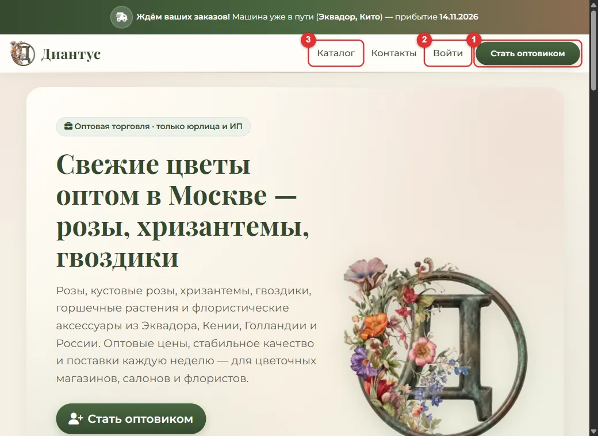

1. **«Стать оптовиком»** — регистрация (раздел 1.3).
2. **«Войти»** — вход, если вы уже зарегистрированы (раздел 1.4).
3. **«Каталог»** — посмотреть товары без регистрации. Цен вы не увидите: они открываются после регистрации.

> **Совет.** На телефоне сайт можно поставить на главный экран, чтобы открывать одним касанием, как приложение (раздел 1.16).

## 1.3 Регистрация: шаг за шагом

**Что подготовить заранее:** название организации (или «ИП Фамилия И. О.»), ИНН (10 цифр у организации, 12 у ИП), телефон, электронную почту, на которую вы можете зайти прямо сейчас.

1. Нажмите **«Стать оптовиком»** (кнопка в правом верхнем углу главной страницы). Откроется форма.
2. Заполните поля. Поля со звёздочкой обязательны.

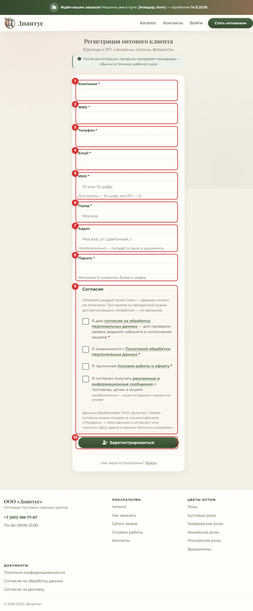

1. **Компания** — название вашей организации или ИП.
2. **ФИО** — имя того, кто будет заказывать.
3. **Телефон** — по которому менеджер сможет вам позвонить (лучше мобильный).
4. **Email** — ваша почта. Она же ваш логин для входа, и на неё придут письма. Потом её нельзя изменить самостоятельно — только через менеджера, поэтому впишите правильную.
5. **ИНН** — 10 цифр для организации, 12 для ИП. Менеджер проверяет компанию по ИНН.
6. **Город.**
7. **Адрес** — не обязателен. Если впишете, он попадёт в заказы и документы.
8. **Пароль** — придумайте и запомните: не короче 8 символов, обязательно буква и цифра.
9. **Согласия.** Каждую галочку нужно поставить **самому**: заранее ничего не отмечено. Три галочки со звёздочкой обязательны: согласие на обработку персональных данных, ознакомление с политикой обработки данных и принятие условий работы и оферты. Четвёртая — «получать рекламные сообщения» — по желанию, на регистрацию она не влияет. Названия документов — это ссылки: можно открыть и прочитать.
10. **«Зарегистрироваться»** — отправить заявку.

**Что будет после отправки:**

1. Откроется страница **«Запрос отправлен»**: заявка ушла менеджеру. Ответ обычно приходит от 15 минут до пары часов в рабочее время, иногда до конца рабочего дня.
2. Пока ждёте, можно посмотреть каталог (без цен).
3. Когда менеджер одобрит заявку, вам придёт письмо или позвонят. После этого можно входить.

> **Если что-то не так.** Сайт пишет красным, что не так с полем (например, «ИНН должен состоять из 10 или 12 цифр»). Исправьте и нажмите кнопку ещё раз. Если ответа нет больше рабочего дня — позвоните менеджеру.

## 1.4 Вход и «Забыли пароль?»

1. Нажмите **«Войти»** вверху страницы.
2. Введите почту и пароль, с которыми регистрировались, и нажмите **«Войти»**.

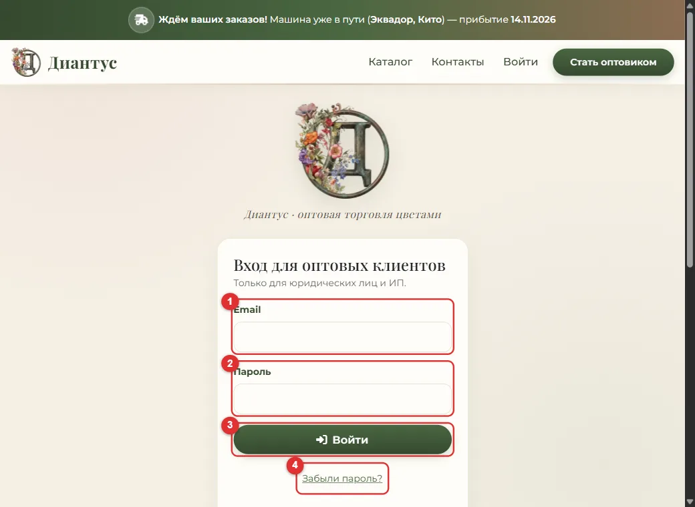

1. **Email** — почта, указанная при регистрации.
2. **Пароль.**
3. **«Войти».** (Поле «Код из приложения» нужно только тем, кто сам включил двухфакторную защиту.)
4. **«Забыли пароль?»**
5. **Регистрация** — если у вас ещё нет доступа.

**Если забыли пароль:**

1. На странице входа нажмите **«Забыли пароль?»**.
2. Введите почту, на которую регистрировались, и нажмите **«Прислать ссылку»**.
3. Откройте письмо (загляните и в папку «Спам»). В нём ссылка для нового пароля: она работает **один раз и 60 минут**.
4. Перейдите по ссылке, введите новый пароль дважды и нажмите **«Сохранить пароль»**.
5. Письмо не пришло? Позвоните менеджеру: он выдаст временный пароль.

> **Важно.** После нескольких неверных попыток входа сайт временно блокирует вход (на 10 минут и дольше): так защищается ваш аккаунт. Подождите и попробуйте снова или восстановите пароль.

## 1.5 Каталог: как найти нужное

После входа нажмите **«Каталог»** в меню вверху. На телефоне — «Главная» в нижней панели.

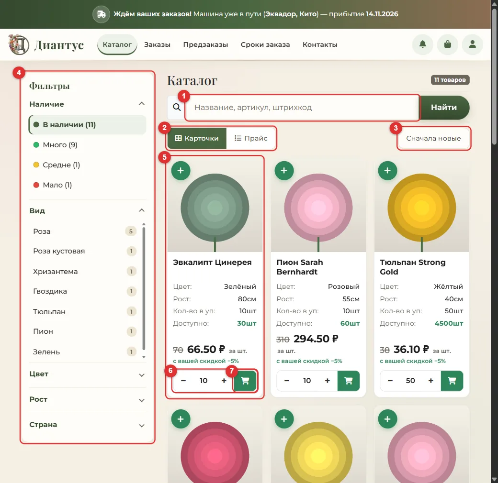

1. **Поиск.** Впишите название, артикул или штрихкод и нажмите **«Найти»**. Крестик справа от слов сбрасывает поиск.
2. **«Карточки» / «Прайс».** Два вида каталога: карточки с крупными фото или компактный прайс-лист «одна строка — один товар» (удобно, когда нужно быстро набрать много позиций). Выбор запоминается.
3. **Сортировка:** «Сначала новые», «Цена ↑», «Цена ↓», «По названию».
4. **Фильтры слева:** «Наличие» (В наличии, Много, Средне, Мало), «Вид» (роза, хризантема, гвоздика…), «Цвет», «Рост» и «Страна». Можно выбрать **несколько значений сразу**: например, красные и белые розы 60 см. Рядом с каждым значением написано, сколько товаров найдётся. Выбранные фильтры видны плашками над товарами; кнопка **«Сбросить фильтры»** возвращает всё как было.
5. **Карточка товара:** фото, название, цвет, рост, сколько штук в упаковке, сколько доступно и **цена за штуку**. Если вам назначена скидка, видна старая цена перечёркнутой и новая — «с вашей скидкой −5%».
6. **Количество.** Кнопки «−» и «+» меняют количество **сразу на целую упаковку**.
7. **Кнопка с корзиной** кладёт выбранное количество в корзину. Зелёный **«+»** в углу фото — быстрый способ: он кладёт в корзину минимальное количество (обычно одну упаковку) одним нажатием.

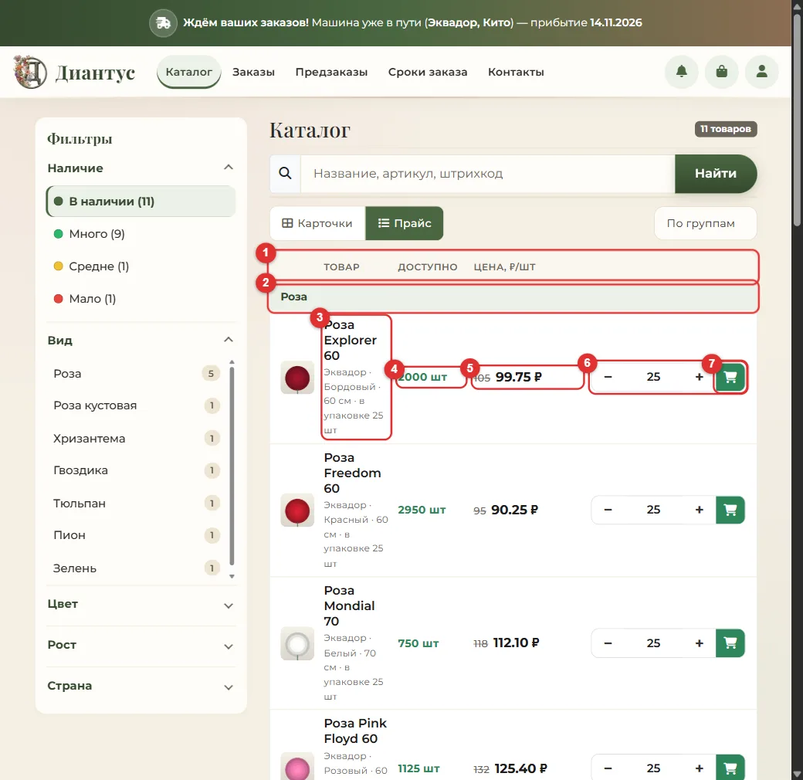

В режиме «Прайс» товары сгруппированы по видам, а всё нужное находится в одной строке:

1. Шапка таблицы. 2. Название группы (вид цветка). 3. Название и описание: страна, цвет, рост, сколько в упаковке. 4. Сколько доступно. 5. Цена за штуку (со скидкой). 6. Количество. 7. Кнопка «В корзину».

В самом низу каталога может быть блок **«Товары в пути (Предзаказ)»** — то, что ещё едет к нам (раздел 1.12).

> **Совет.** Не нашли нужное слово — попробуйте короче («мондиал», а не «Мондиал 60 Tessa») или поищите по фильтрам.

**Что видит человек без регистрации.** Каталог открыт всем, но вместо цены написано «Цена после регистрации», а вместо кнопки заказа — приглашение стать оптовиком.

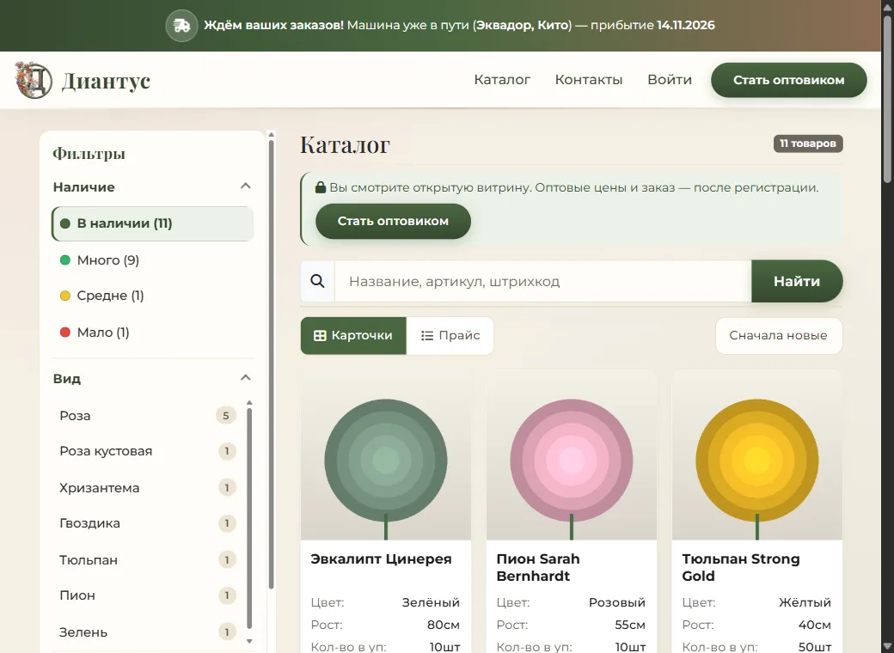

## 1.6 Страница товара

Нажмите на фото или название товара — откроется подробная страница.

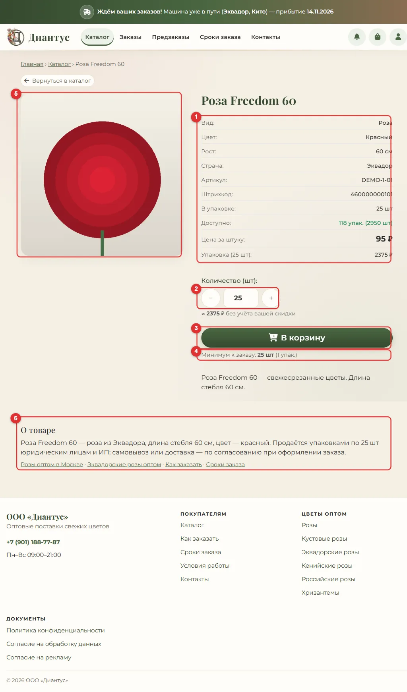

1. **Характеристики:** вид, цвет, рост, страна, артикул, штрихкод, сколько в упаковке, сколько доступно (в упаковках и штуках), цена за штуку и за упаковку.
2. **Количество в штуках.** Меняется кнопками «−» и «+» на целую упаковку. Под полем показана примерная сумма «без учёта вашей скидки»: скидка применится в корзине.
3. **«В корзину».**
4. **«Минимум к заказу»:** меньше этого количества заказать нельзя.
5. **Фото.** Если их несколько, под фото стрелки и точки для перелистывания.
6. **«О товаре»:** короткое описание и ссылки на разделы («Розы оптом», «Как заказать», «Сроки заказа»).

## 1.7 Упаковки и минимальный заказ: правило, которое нужно запомнить

* Цветы продаются **упаковками**. Если в упаковке 25 штук, то можно заказать 25, 50, 75… штук — но не 30.
* **Цена в каталоге — за одну штуку.** Стоимость упаковки = цена штуки × штук в упаковке. Например: 95 ₽ × 25 шт = 2375 ₽.
* В каталоге и на странице товара количество считается **в штуках**, а в корзине — **в упаковках**.
* У каждого товара есть минимум к заказу (чаще всего одна упаковка). Он указан в карточке.

## 1.8 Корзина

Нажмите значок сумки в правом верхнем углу (на телефоне — «Корзина» внизу). Цифра на значке — сколько позиций в корзине.

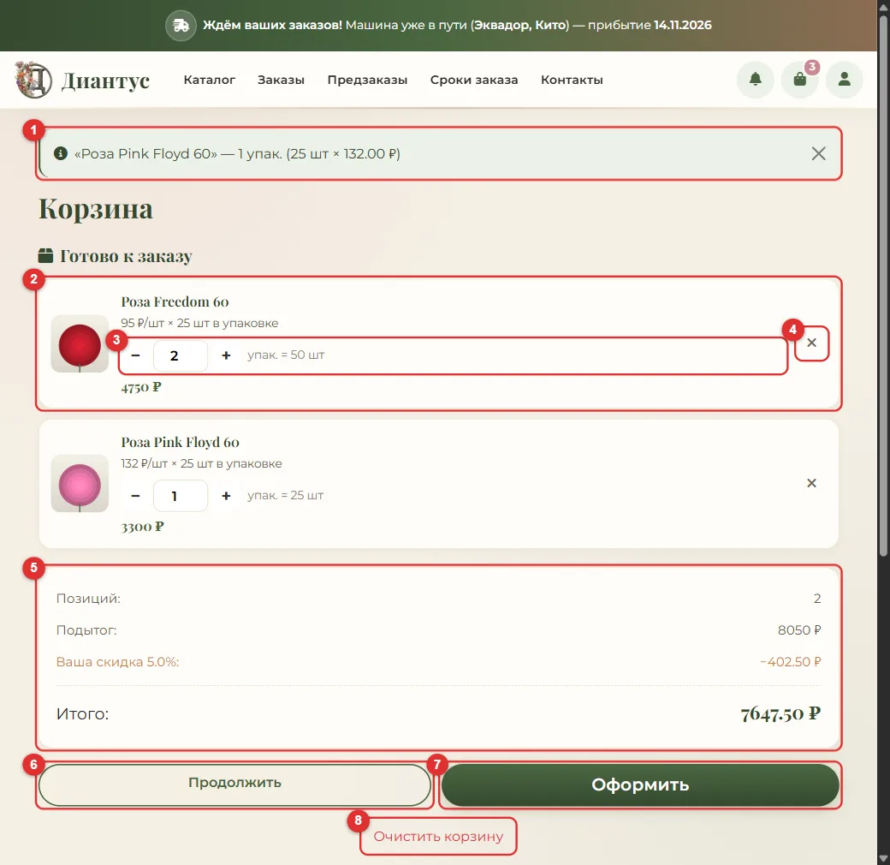

1. Сообщение о том, что только что добавлено.
2. Строка товара: название, цена за штуку × штук в упаковке, сумма по строке.
3. **Количество в упаковках.** «−» и «+» меняют на одну упаковку; справа подписано, сколько это штук.
4. **Крестик** — убрать товар из корзины.
5. **Итоги:** сколько позиций, подытог, **ваша скидка** (если назначена) и **итого к оплате**.
6. **«Продолжить»** — вернуться в каталог и добавить ещё.
7. **«Оформить»** — перейти к оформлению заказа.
8. **«Очистить корзину»** — убрать всё сразу.

> **Важно.** Корзина хранится, пока вы не вышли из аккаунта (несколько дней без активности). Но цены и остатки меняются, поэтому не оставляйте корзину «на потом»: оформите заказ сразу, а если корзина стояла долго — проверьте количество и цены.

## 1.9 Оформление заказа

В корзине нажмите **«Оформить»**.

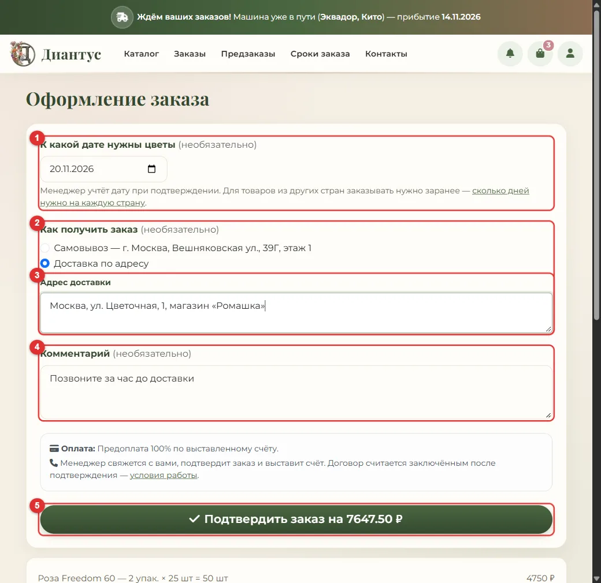

1. **К какой дате нужны цветы** — необязательно, но очень полезно: менеджер учтёт дату при подтверждении. Цветы едут из других стран, поэтому заказывать нужно заранее: сколько дней нужно на каждую страну — по ссылке под полем (страница «Сроки заказа», раздел 1.13).
2. **Как получить заказ:** «Самовывоз» (адрес склада написан тут же) или «Доставка по адресу».
3. **Адрес доставки** появляется, когда вы выбрали доставку: впишите город, улицу, дом, этаж, как проехать.
4. **Комментарий** — любые пожелания: «позвоните за час до доставки», «нужна досрочная отгрузка».
5. **«Подтвердить заказ на … ₽».** Под кнопкой — условия оплаты («Предоплата 100% по выставленному счёту») и напоминание, что договор считается заключённым после подтверждения менеджером.

Ниже на странице видно ещё раз, что вы заказываете. Чтобы поменять количество, нажмите «← Вернуться в корзину и изменить количество».

> **Важно.** Нажимайте **«Подтвердить заказ»** один раз. После нажатия откроется список ваших заказов, и новый заказ будет первым. Дважды заказ не оформится: сайт защищён от случайного двойного нажатия.

## 1.10 Что происходит с заказом дальше

1. Заказ появляется в **«Мои заказы»** со статусом **«Новый»**. Вам уходит письмо, а менеджеру — уведомление.
2. Менеджер звонит или пишет, если нужно что-то уточнить (дату, замену товара, доставку), затем **подтверждает** заказ — статус **«Подтверждён»** — и выставляет **счёт**.
3. Вы оплачиваете счёт по реквизитам. Счёт можно скачать на сайте: **«Счёт PDF»** в карточке заказа.
4. Склад собирает заказ — статус **«В работе»**; затем заказ **«Отправлен»** (отгружен или передан доставке) и, наконец, **«Выполнен»**.
5. Каждый раз, когда статус меняется, вы получаете **уведомление** на сайте (значок колокольчика вверху, цифра на нём — сколько новых) и письмо.

Если заказ **отменили**, статус будет **«Отменён»**: товар вернётся в продажу.

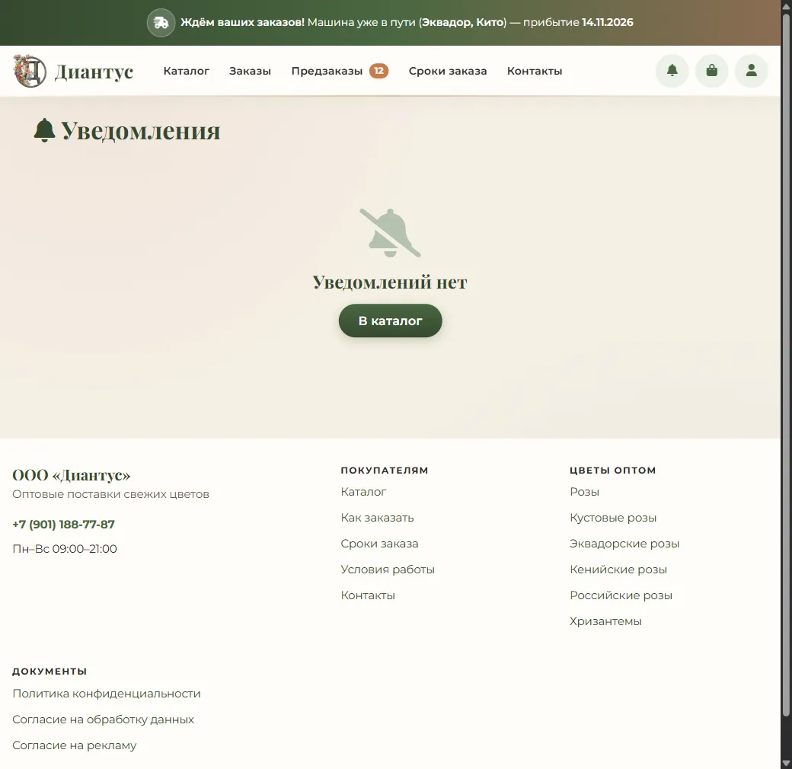

> **Совет.** Если нужна срочная связь с менеджером — звоните. Телефон и часы работы указаны на странице «Контакты» и внизу каждой страницы.

## 1.11 «Мои заказы»

Меню **«Заказы»** (на телефоне — «Заказы» внизу). Здесь все ваши заказы, новые сверху.

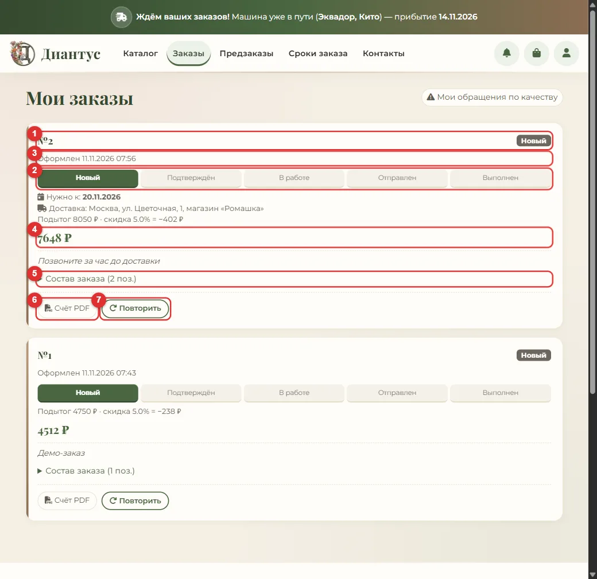

1. **Номер заказа и текущий статус.**
2. **Этапы заказа:** «Новый → Подтверждён → В работе → Отправлен → Выполнен». Закрашенный этап — где заказ сейчас.
3. Когда заказ оформлен. Ниже — дата, к которой нужны цветы, способ получения, подытог и скидка.
4. **Сумма заказа.**
5. **«Состав заказа»** — нажмите, чтобы раскрыть список товаров.
6. **«Счёт PDF»** — скачать счёт.
7. **«Повторить»** — положить в корзину те же товары по сегодняшним ценам и остаткам. Сайт сообщит, что добавлено и что недоступно (если чего-то уже нет).

Если заказ в статусе **«Отправлен»** или **«Выполнен»**, рядом появится кнопка **«Сообщить о проблеме»** (раздел 1.14).

## 1.12 Предзаказ: цветы, которые ещё едут

**Когда нужен.** Машина с цветами ещё в пути, а вы хотите занять товар заранее.

1. В каталоге внизу найдите блок **«Товары в пути (Предзаказ)»** (или откройте такую карточку: на ней отметка «В пути — можно оформить предзаказ»).
2. В карточке видно, откуда цветы, когда ждём машину и сколько в упаковке.
3. Выберите количество и нажмите **«Оформить предзаказ»**. Цена и скидка — как у обычного товара.
4. Предзаказы лежат в меню **«Предзаказы»**.

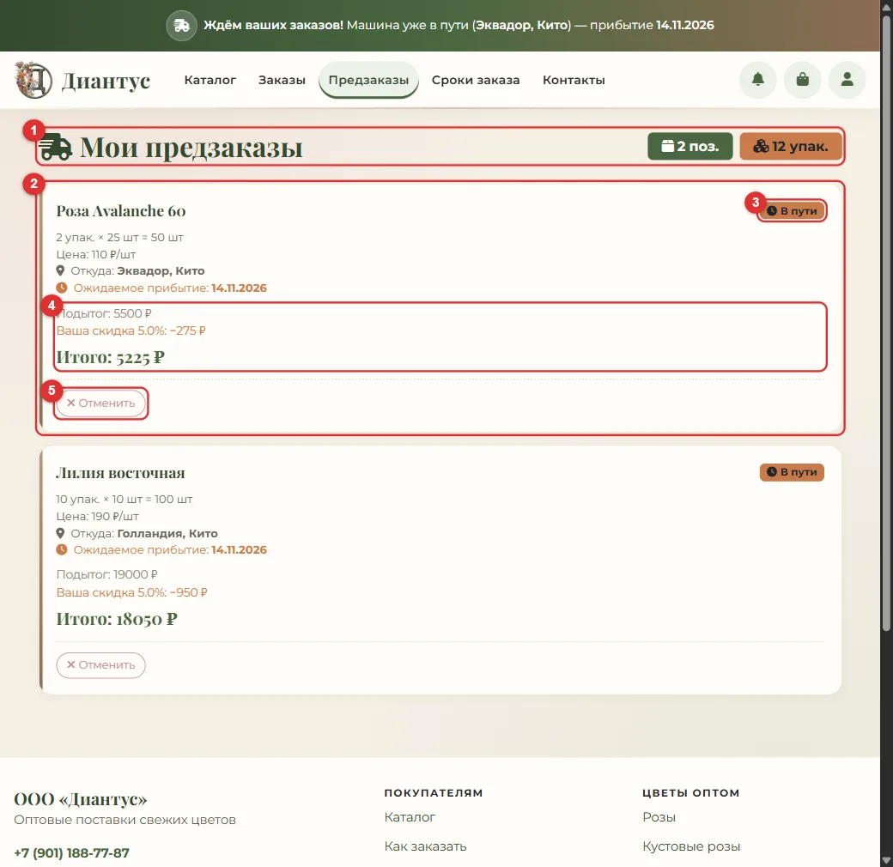

1. Сколько у вас предзаказов (позиций и упаковок).
2. Карточка предзаказа: сколько заказано, цена, откуда, ожидаемое прибытие.
3. **«В пути»** — товар ещё едет. Когда машину принимают на склад, статус меняется на **«Поступил»**.
4. Расчёт: подытог, скидка, итого.
5. **«Отменить»** — отказаться от предзаказа.

Когда машина прибывает, вы получаете уведомление, а предзаказ переходит в **корзину** (с пометкой «из предзаказа»). Если оформить его не успели и товар разобрали, на карточке будет написано «Товар уже распродан». После поступления на карточке появляется кнопка **«В корзину»**.

## 1.13 «Сроки заказа»: до какого числа успеть

Цветы везут из других стран, поэтому для разных стран нужно разное время. Страница показывает, **до какого числа** нужно заказать, чтобы цветы были к нужной дате. Меню «Сроки заказа» (ссылка есть и внизу любой страницы).

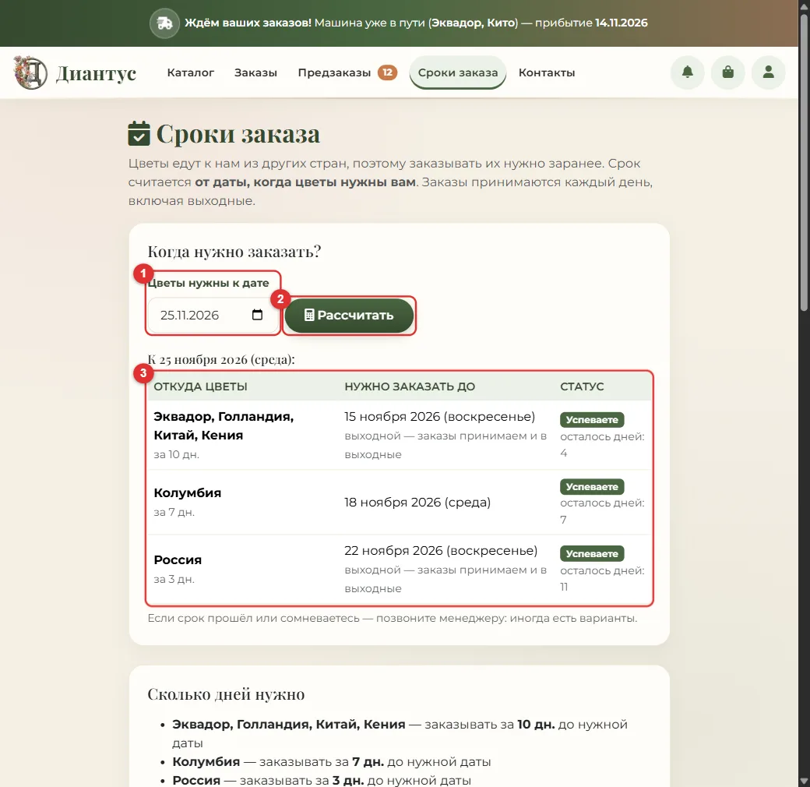

1. Выберите **дату**, к которой нужны цветы.
2. Нажмите **«Рассчитать»**.
3. В таблице для каждой страны написано, **до какого числа** заказать, и стоит отметка: «Успеваете» (с числом оставшихся дней), «Последний день — сегодня» или «Срок прошёл» (и когда цветы будут, если заказать сегодня).

Ниже страница показывает, **за сколько дней** заказывать для каждой страны, и ближайшие праздники (14 февраля, 8 марта и т. д.) с готовыми датами. Заказы принимаются каждый день, включая выходные.

> **Совет.** Срок прошёл или сомневаетесь — позвоните менеджеру: иногда есть варианты.

## 1.14 Если с цветами что-то не так

Цветы — скоропортящийся товар, поэтому лучше написать **в течение суток после получения**.

1. Откройте **«Заказы»** и найдите нужный заказ (кнопка есть у заказов «Отправлен» и «Выполнен»).
2. Нажмите **«Сообщить о проблеме»**. Откроется форма.

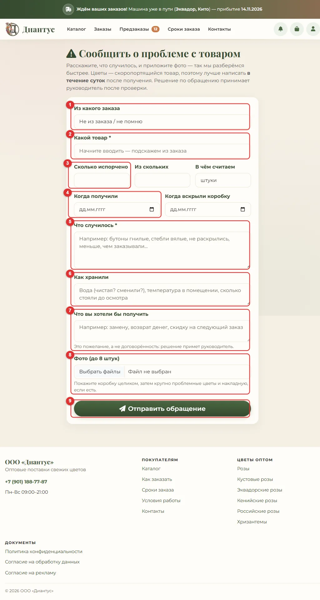

1. **Из какого заказа** — выберите заказ или «Не из заказа / не помню».
2. **Какой товар** — начните вводить название: сайт подскажет из заказа.
3. **Сколько испорчено, из скольких** и **в чём считаем** (штуки или упаковки).
4. **Когда получили** и **когда вскрыли коробку** — даты.
5. **Что случилось** — обязательное поле: опишите словами («бутоны потемнели», «стебли вялые», «меньше, чем заказывали»).
6. **Как хранили** — вода (чистая? меняли?), температура, сколько стояли до осмотра. Это помогает разобраться.
7. **Что вы хотели бы получить** — замена, возврат денег, скидка. Это пожелание, а не договорённость: решение принимает руководитель.
8. **Фото.** Покажите коробку целиком, затем крупно проблемные цветы и накладную, если есть.
9. **«Отправить обращение».**

**Что будет после отправки:**

1. Обращение получает номер вида **РЕК-0001**. Следить за ним можно в **«Мои обращения по качеству»** (кнопка вверху страницы «Мои заказы»).
2. Ответ появится на странице обращения; вам придёт уведомление и письмо.

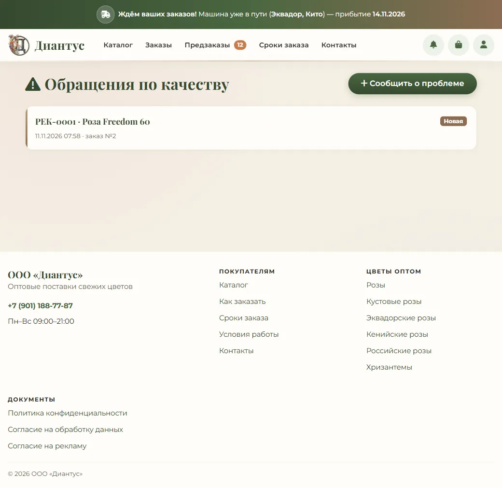

> **Важно.** Менеджер ничего не обещает сразу: решение принимает руководитель после проверки. Не удаляйте цветы и упаковку, пока вопрос не решён.

## 1.15 Профиль: ваши данные, пароль, согласия

Нажмите значок человечка в правом верхнем углу (на телефоне — «Профиль»).

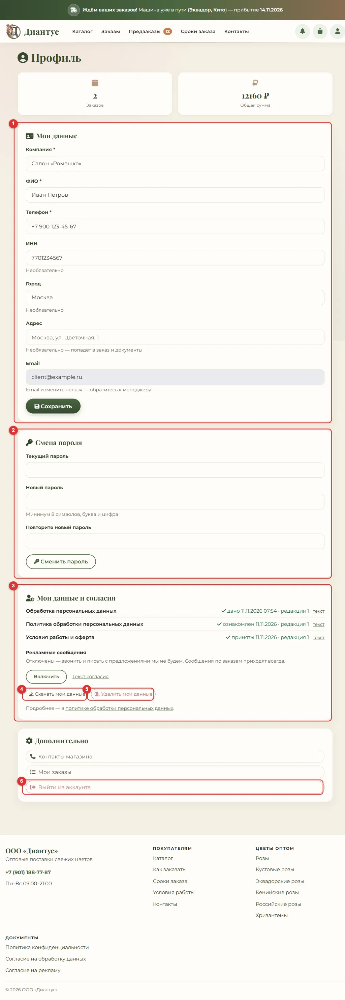

1. **Мои данные:** компания, ФИО, телефон, ИНН, город, адрес. Измените нужное и нажмите **«Сохранить»**. Email изменить нельзя — обратитесь к менеджеру.
2. **Смена пароля:** текущий пароль, затем новый дважды. Ниже — **двухфакторная защита (2FA)**: необязательная, но надёжная. Включить её можно через приложение «Яндекс.Ключ» или Google Authenticator: отсканируйте QR-код и введите шестизначный код.
3. **Мои данные и согласия:** какие согласия вы дали, когда и по какой редакции текстов. Рекламные сообщения можно включить и отключить в любой момент: на сообщения по заказам это не влияет, они приходят всегда.
4. **«Скачать мои данные»** — файл со всеми сведениями о вас, которые хранит сайт.
5. **«Удалить мои данные»** — запрос на удаление. Сайт ответит на него в срок, установленный законом.
6. **«Выйти из аккаунта»** — обязательно нажимайте на чужом или общем компьютере.

## 1.16 Сайт на телефоне

Сайт подстраивается под экран телефона. Меню переезжает вниз: **Главная** (каталог), **Заказы**, **Предзаказы**, **Корзина**, **Профиль**.

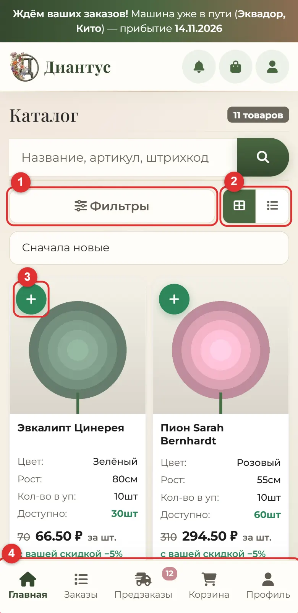

1. **«Фильтры»** — открывает панель с фильтрами (картинка ниже).
2. Переключатель **«Карточки» / «Прайс»**.
3. Зелёный **«+»** — положить минимальное количество в корзину.
4. **Нижняя панель:** все основные разделы под большим пальцем.

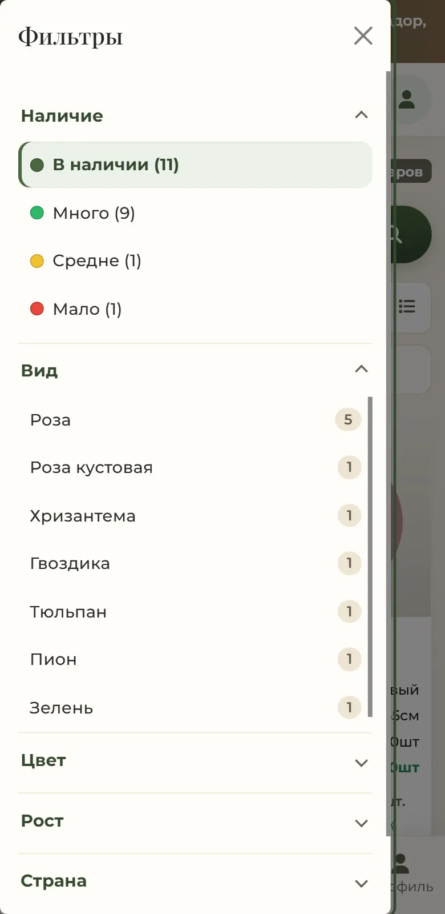

Выберите нужные значения и нажмите **«Показать товары (N)»**: панель закроется, останутся только выбранные товары.

**Как поставить сайт на главный экран**, чтобы открывать как приложение:

* **Android (Chrome, Яндекс Браузер):** нажмите **«Установить»** в плашке внизу экрана (она появляется на главной и в каталоге) или выберите в меню браузера «Установить приложение» / «Добавить на главный экран».
* **iPhone (Safari):** нажмите значок **«Поделиться»** (квадрат со стрелкой) и выберите **«На экран Домой»**.

Плашку можно закрыть крестиком: она не появится ещё какое-то время.

## 1.17 Частые вопросы

На сайте есть страница **«Как заказать»** (ссылка внизу любой страницы, адрес dianthus-opt.ru/help): там коротко повторены шаги из этого руководства и ответы на частые вопросы — кто может покупать, почему не видно цен, как оплатить, что делать с браком.

# Часть 2. Менеджеру

Менеджер — это сотрудник, который принимает заказы и новых клиентов. Роль «менеджер» выдаёт владелец (раздел 3.3). Менеджеру не показываются выручка, настройки, справочник товаров, поставки, интеграция с 1С и юридические разделы: это забота владельца.

## 2.1 Как войти в админку

1. Откройте dianthus-opt.ru и войдите под своей почтой и паролем (раздел 1.4).
2. В правом верхнем углу нажмите значок **шестерёнки**. Откроется админка.
3. Вернуться на «обычный» сайт можно кнопкой «Каталог» в меню.

> **Совет.** Включите двухфакторную защиту в «Профиле» (раздел 1.15): тогда пароль, даже украденный, не откроет админку.

## 2.2 Главный экран: что сделать сегодня

Откройте админку каждое утро и начните с блока **«Что сделать сегодня»**.

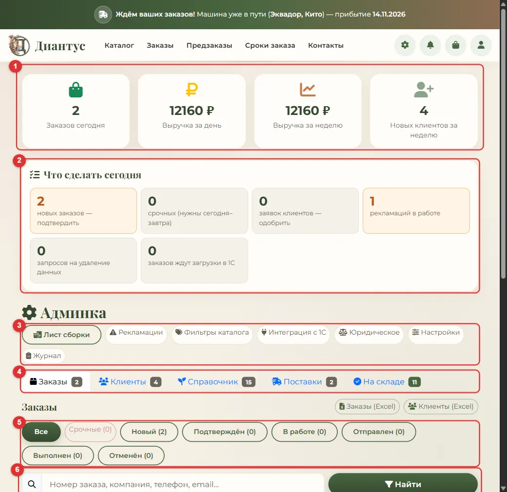

1. **Цифры дня:** заказов сегодня, выручка за день и за неделю, новых клиентов за неделю (суммы видит только владелец).
2. **«Что сделать сегодня»** — плитки с числами: новые заказы (подтвердить), срочные (цветы нужны сегодня–завтра), заявки клиентов (одобрить), рекламации в работе, запросы на удаление данных, заказы, ждущие загрузки в 1С. Выделенная цветом плитка — то, что ждёт вас. Нажмите на плитку, чтобы сразу перейти к нужным записям.
3. **Кнопки разделов:** «Лист сборки», «Рекламации», «Фильтры каталога», «Интеграция с 1С», «Юридическое», «Настройки», «Журнал». Менеджеру доступны «Лист сборки» и «Рекламации».
4. **Вкладки:** «Заказы», «Клиенты» (цифра — сколько заявок ждут), «Справочник», «Поставки», «На складе».
5. **Фильтры по статусу:** «Все», «Срочные», «Новый», «Подтверждён», «В работе», «Отправлен», «Выполнен», «Отменён» — в скобках сколько заказов в каждом.
6. **Поиск:** по номеру заказа, названию компании, телефону или почте.
7. **Таблица заказов:** номер, клиент и телефон, «Нужно к» (дата и способ получения), сумма, когда создан, статус и блок «Изменить»: значок «глаз» открывает заказ, а выпадающий список со статусом и кнопка «ОК» меняют статус прямо из списка.

## 2.3 Как принять новый заказ: шаг за шагом

1. В админке откройте вкладку **«Заказы»** и нажмите фильтр **«Новый»**.
2. Откройте заказ: нажмите значок «глаз» в его строке.

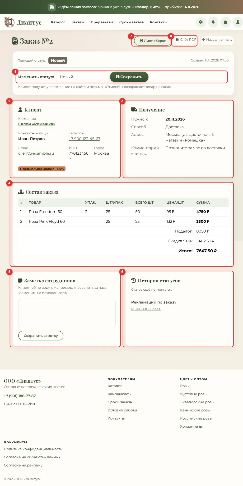

1. **«Изменить статус»:** выберите новый статус в списке и нажмите **«Сохранить»**. Клиент получит уведомление на сайте и письмо. Выше видно текущий статус и когда заказ создан.
2. **Клиент:** компания, контактное лицо, телефон (на телефоне по нему можно позвонить нажатием), почта, ИНН, город и отметка **«Персональная скидка»**, если она назначена.
3. **Получение:** к какой дате нужны цветы, самовывоз или доставка, адрес и комментарий клиента.
4. **Состав заказа:** товар, упаковки, штук в упаковке, всего штук, цена и сумма; внизу подытог, скидка и итого.
5. **Заметка сотрудников:** внутренняя запись (клиент её не видит), например «позвонить за час» или «заменить на похожий сорт». Нажмите **«Сохранить заметку»**.
6. **История статусов:** кто и когда менял статус. Здесь же видны рекламации по заказу.
7. **«Лист сборки»** — печатная страница для склада по этому заказу.
8. **«Счёт PDF»** — счёт для клиента: его можно скачать и отправить.

**Порядок работы с заказом:**

1. Проверьте состав и дату «Нужно к». Если нужной даты не успеть — смотрите страницу «Сроки заказа» и предупредите клиента.
2. Позвоните клиенту, если нужно уточнить дату, доставку или замену.
3. Передайте заказ оператору 1С: он создаёт документ в 1С и резервирует товар (часть 4). Только **после этого** ставьте **«Подтверждён»** — либо оператор отправит этот статус из 1С сам.
4. Выставите и отправьте клиенту **счёт** («Счёт PDF»).
5. Когда склад собирает заказ — **«В работе»**, когда отправили — **«Отправлен»**, когда клиент получил — **«Выполнен»**.

## 2.4 Какой статус когда ставить

| Статус | Когда ставить | Что видит клиент |
|---|---|---|
| **Новый** | Ставится сам, когда клиент оформил заказ | «Заказ принят сайтом» |
| **Подтверждён** | Вы поговорили с клиентом, заказ в 1С создан и товар зарезервирован | Письмо и уведомление: заказ принят в работу |
| **В работе** | Склад начал собирать | Уведомление |
| **Отправлен** | Заказ отгружен или передан в доставку | Уведомление; у клиента появляется кнопка «Сообщить о проблеме» |
| **Выполнен** | Клиент получил цветы | Уведомление |
| **Отменён** | Заказ точно отменён (клиент отказался, не договорились). **Товар возвращается на склад сайта** | Уведомление |

> **Важно.** **«Отменён»** возвращает товар в продажу. Ставьте его только когда заказ точно отменён, и не ставьте для «проверки»: изменить обратно будет нельзя.

> **Совет.** Если статусы ведёт 1С (оператор отправляет их своей обработкой), не дублируйте их вручную на сайте: достаточно одного источника.

## 2.5 Лист сборки

Лист сборки нужен складу. Есть два вида:

* **По одному заказу:** кнопка «Лист сборки» на странице заказа.
* **Сводный:** на главном экране админки кнопка **«Лист сборки»** — все активные заказы («Новый», «Подтверждён», «В работе») сразу.

Подробности и картинка — в части 5.

## 2.6 Новые клиенты: заявки

Когда человек регистрируется, на главном экране загорается плитка **«заявок клиентов — одобрить»**, а на вкладке «Клиенты» появляется цифра.

1. Откройте вкладку **«Клиенты»**. Заявки стоят первыми, у них статус **«Ожидает»**.

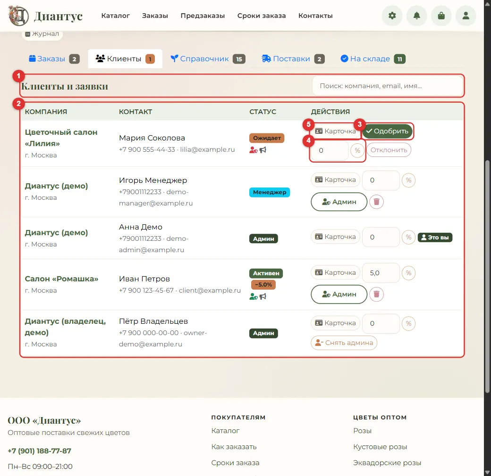

1. **Поиск** по названию компании, почте или имени.
2. **Таблица клиентов:** компания, контакт, статус («Ожидает», «Активен», «Менеджер», «Админ») и действия. Значки под статусом: щит — дал ли клиент согласие на обработку данных, рупор — разрешил ли рекламу.
3. **«Одобрить»** — открыть доступ. Клиент получит письмо.
4. **Скидка, %** — число в процентах (только владелец).
5. **«Карточка»** — подробные сведения о клиенте.

**Порядок:**

1. **Проверьте компанию.** Зайдите на сайт налоговой egrul.nalog.ru, введите ИНН из заявки и убедитесь, что организация (или ИП) действует и название совпадает.
2. Если всё в порядке — нажмите **«Одобрить»**.
3. Если заявка подозрительная (не компания, чужие данные, дубль, спам), не одобряйте и сообщите владельцу: удалить заявку («Отклонить») может только он.

Нажав **«Карточку»** (или название компании), вы откроете страницу клиента.

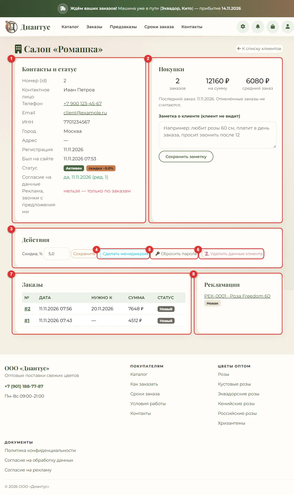

1. **Контакты и статус:** телефон, почта, ИНН, город, согласия на данные и рекламу, когда заходил.
2. **Покупки:** сколько заказов и на какую сумму, средний чек.
3. **Действия:** заметка о клиенте (внутренняя) и кнопки владельца.
4. **«Сделать менеджером»** — выдать сотруднику роль менеджера (владелец).
5. **«Сбросить пароль»** — сайт покажет **новый временный пароль один раз**: продиктуйте его клиенту по телефону (владелец).
6. **«Удалить данные клиента»** — стереть личные данные по запросу (владелец). Если у клиента есть заказы, они сохраняются для бухгалтерии как «Клиент №N (данные удалены)».
7. **Заказы** клиента, 8. его **рекламации**.

## 2.7 Обращения по качеству (рекламации)

Когда клиент нажимает «Сообщить о проблеме», вам приходит письмо, а на главном экране загорается плитка «рекламаций в работе». Откройте **«Рекламации»** → нужное обращение.

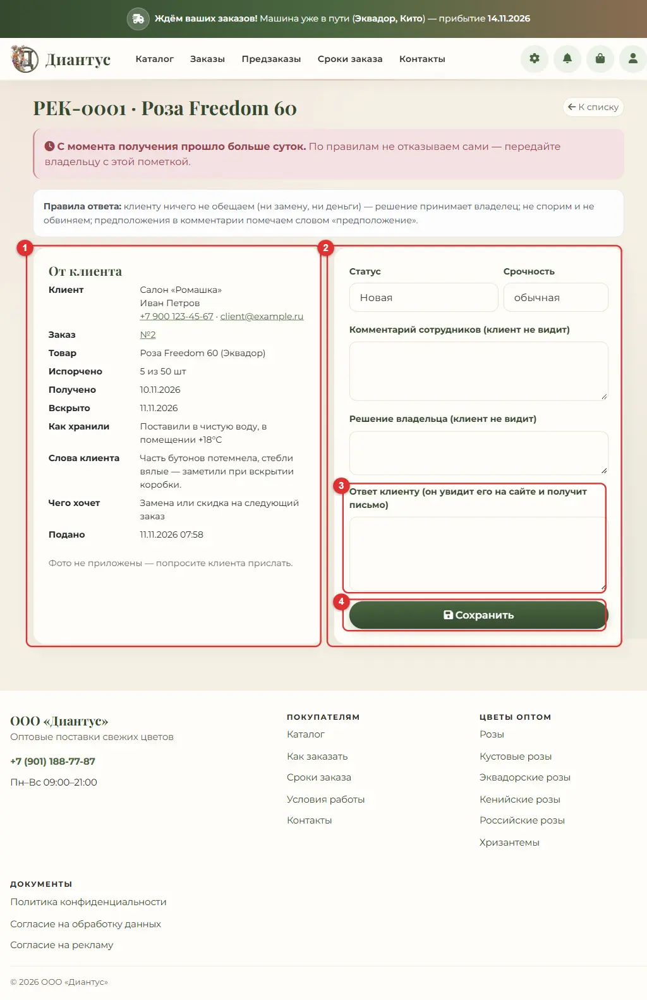

1. **От клиента:** кто, из какого заказа, какой товар, сколько испорчено, даты, как хранили, слова клиента, что он хочет получить, фото.
2. **Статус и срочность**, а также два внутренних поля — «Комментарий сотрудников» и «Решение владельца» (клиент их **не** видит).
3. **«Ответ клиенту»** — то, что клиент увидит на сайте и получит письмом.
4. **«Сохранить».**

**Правила ответа** (они напечатаны на самой странице):

* **Клиенту ничего не обещаем** — ни замену, ни деньги: решение принимает владелец.
* Не спорим и не обвиняем. Предположения в комментарии помечаем словом «предположение».
* Если с момента получения прошло **больше суток**, страница подсвечена красным: сами не отказывайте, передайте владельцу с этой пометкой.
* Пишите вежливо и по делу, например: «Спасибо, что сообщили. Мы получили ваши фото и передали обращение руководителю. Ответим до конца следующего рабочего дня».

## 2.8 Что менеджер не делает

Это работа владельца: скидки клиентам, удаление и «Отклонить» заявки, сброс пароля и назначение менеджеров, справочник товаров, фильтры каталога, поставки, интеграция с 1С, юридические тексты, настройки, решение по рекламации. Если нужно что-то из этого, обратитесь к владельцу.

# Часть 3. Владельцу

Здесь — то, что нужно именно вам. Технические подробности (сервер, обновление, резервные копии) собраны в «Памятке владельцу» — файл `docs/ВЛАДЕЛЬЦУ.md`; здесь — как работать с сайтом изо дня в день.

## 3.1 Первая неделя: что сделать обязательно

| № | Что сделать | Где |
|---|---|---|
| 1 | Сменить пароль и включить двухфакторную защиту (2FA) | «Профиль» (раздел 1.15) |
| 2 | Заполнить реквизиты организации и ответственного за персональные данные | «Настройки» (раздел 3.5) |
| 3 | Показать юридические тексты юристу, подать уведомление в Роскомнадзор | «Юридическое» (раздел 3.9) |
| 4 | Подключить 1С: создать ключ и передать его программисту или оператору | «Интеграция с 1С» (раздел 3.8) |
| 5 | Проверить, что письма с сайта доходят (пробный заказ, «Забыли пароль?») | `docs/ВЛАДЕЛЬЦУ.md`, раздел 8 |
| 6 | Выдать сотрудникам роль менеджера | Карточка клиента (раздел 3.3) |
| 7 | Провести **тестовый заказ целиком** со своим вторым адресом почты | часть 1 этого руководства |

## 3.2 Ежедневная работа

* Утром откройте админку и посмотрите **«Что сделать сегодня»** (раздел 2.2).
* Проверьте плашку на странице **«Интеграция с 1С»**: зелёная — всё работает (раздел 3.8).
* В каталоге под заголовком должна быть строка «Цены обновлены сегодня»: вчерашняя дата означает, что обмен остановился.
* Просмотрите новые рекламации: решение по ним принимаете вы (раздел 2.7).

## 3.3 Сотрудники и права

Роль «менеджер» выдаёте вы: человек сначала **регистрируется как обычный клиент**, вы его одобряете, затем открываете его карточку (вкладка «Клиенты» → «Карточка») и нажимаете **«Сделать менеджером»**. Чтобы забрать роль (например, при увольнении), в карточке есть кнопка «Забрать роль менеджера»; при необходимости сразу сбросьте пароль.

| | Покупатель | Менеджер | Владелец |
|---|:--:|:--:|:--:|
| Смотреть каталог и цены, заказывать | да | да | да |
| Заказы: смотреть, подтверждать, менять статус, листы сборки, счета | | да | да |
| Клиенты: смотреть карточки, одобрять заявки, писать заметки | | да | да |
| Рекламации: отвечать клиентам | | да | да |
| Выручка и суммы по дням | | | да |
| Скидки клиентам, удаление клиентов и «Отклонить» заявку, сброс пароля, назначение менеджеров | | | да |
| Справочник товаров, фильтры каталога, поставки, склад | | | да |
| Интеграция с 1С, юридические тексты, настройки | | | да |
| Решение по рекламации | | | да |

**Скидка клиенту.** На вкладке «Клиенты» в строке клиента впишите число (проценты) в поле скидки и нажмите значок «%» рядом. Скидка применяется в корзине и в заказе автоматически: клиент видит старую и новую цену.

## 3.4 Если клиент не может войти

1. Убедитесь, что он **одобрен** (вкладка «Клиенты», статус «Активен»).
2. Клиент забыл пароль — пусть нажмёт «Забыли пароль?»: он сам получит письмо (нужна настроенная почта).
3. Письма не доходят — откройте его карточку и нажмите **«Сбросить пароль»**: сайт покажет временный пароль один раз. Продиктуйте его по телефону и попросите сменить в «Профиле».
4. Вход блокируется на время после нескольких неверных попыток: подождите 10 минут.

## 3.5 Настройки магазина

Откройте шестерёнку → **«Настройки»**.

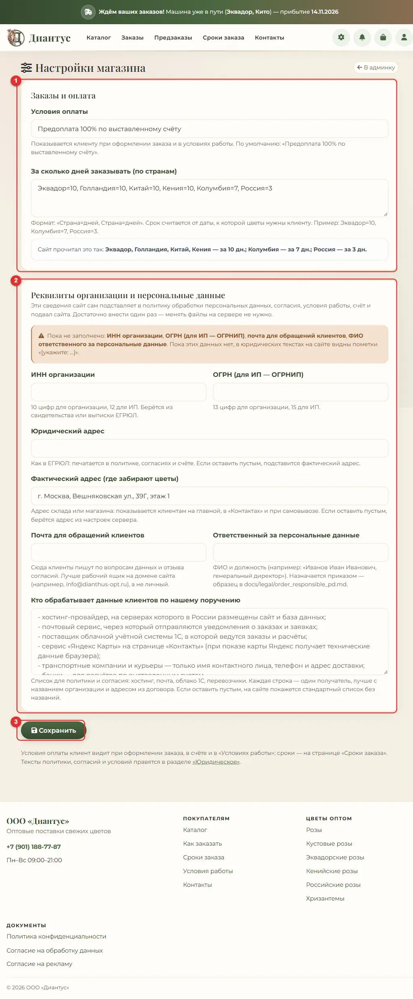

1. **Заказы и оплата.**
   * **Условия оплаты** — текст, который клиент видит при оформлении заказа, в счёте и в «Условиях работы» (сейчас — «Предоплата 100% по выставленному счёту»).
   * **За сколько дней заказывать (по странам)** — формат «Страна=дней, Страна=дней», например: Эквадор=10, Колумбия=7, Россия=3. От этих чисел зависит страница «Сроки заказа». Под полем сайт показывает, как он прочитал ваши слова.
2. **Реквизиты организации и персональные данные.** Заполните один раз: ИНН, ОГРН (для ИП — ОГРНИП), юридический адрес, **фактический адрес** (где забирают цветы), почту для обращений клиентов, **ответственного за персональные данные** (ФИО и должность) и тех, кто обрабатывает данные клиентов по вашему поручению (хостинг, почта, облако 1С, перевозчики). Эти сведения сайт сам подставляет в политику, согласия, условия работы, счёт и подвал сайта.
3. **«Сохранить».** Тексты на сайте обновятся сразу.

> **Важно.** Пока реквизиты не заполнены, в юридических текстах на сайте видны пометки «[укажите: …]». Это плохо и для клиентов, и по закону: заполните их в первую очередь.

## 3.6 Товары, поставки и склад

* **Справочник** — карточки товаров: название, вид, цвет, рост, страна, артикул, штрихкод, фото, описание.
* **Поставки** — машины с цветами. Пока 1С не подключена, остатки ведёте вы: «Новая поставка» → страна, дата прибытия, товары → когда машина прибыла, кнопка **«Разгрузить»**: товар попадает в каталог, а клиенты с предзаказами получают уведомление.
* **На складе** — что сейчас в наличии.

После подключения 1С **товары, цены, остатки и поставки ведёт 1С**: сайт получает их от обработки (часть 4). Такие поставки в админке помечены «из 1С»; **цифры на сайте руками не правьте** — они перезапишутся данными из 1С.

## 3.7 Фильтры каталога: вид, цвет, рост, страна

Шестерёнка → **«Фильтры каталога»**: четыре списка, по которым покупатели отбирают товары.

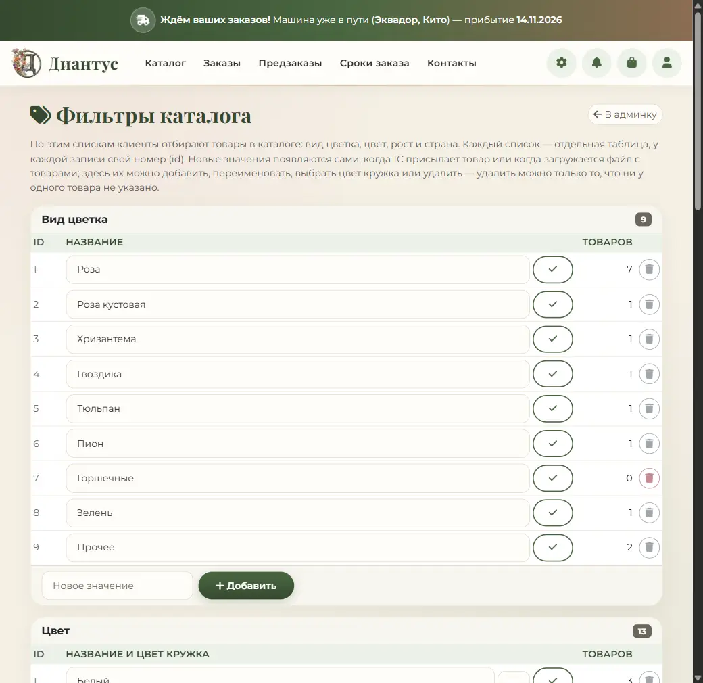

* **Добавить** значение (например, новый цвет) и выбрать цвет кружка в фильтре.
* **Переименовать** — товары сохранят привязку, меняется только подпись.
* **Удалить** можно только то, что ни у одного товара не указано (справа видно, у скольких товаров используется значение).

Новые значения часто появляются сами, когда 1С присылает товар с цветом или ростом, которых ещё нет. Если там опечатка, поправьте здесь.

## 3.8 Интеграция с 1С

Шестерёнка → **«Интеграция с 1С»**. Здесь вы управляете связью сайта с 1С; программисту или оператору достаточно ключа.

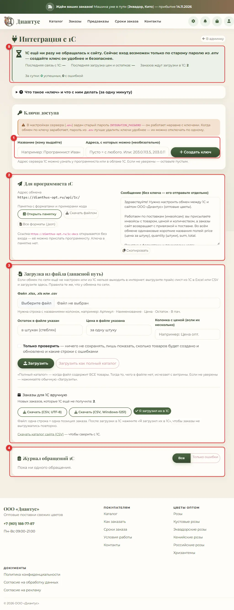

1. **«Создать ключ».** Впишите, кому он выдаётся («Оператор Иван»), нажмите кнопку. **Ключ показывается один раз** — скопируйте его сразу. Потерялся — создайте новый; ненужный ключ отключается одним нажатием.
2. **«Для программиста 1С»:** адрес обмена, ссылка на памятку с форматами и **готовое сообщение**, которое можно скопировать. Сообщение отправляйте личным письмом, **ключ — отдельным сообщением**.
3. **«Загрузка из файла»** — запасной путь, если из 1С нельзя выходить в интернет: выгрузите прайс из 1С в Excel и загрузите здесь. Всегда сначала ставьте галочку **«Только проверить»**: сайт покажет, что изменится, и ничего не сохранит. Ниже — блок «Заказы для 1С вручную».
4. **«Журнал обращений 1С»:** кто и когда обращался, чем закончилось. Кнопка «Только ошибки» оставляет только неудачные обращения.
5. **Плашка вверху** показывает состояние обмена цветом: **зелёная** — всё работает; **жёлтая** — 1С давно не обращалась; **красная** — последнее обращение закончилось ошибкой (причина написана простыми словами); **голубая** — ключ создан, но 1С ещё не заходила.

**Что решаете именно вы** (оператор или программист задаст эти вопросы): какую цену отправлять на сайт («Цена опт.» или «Мелкий опт»); по каким складам считать остаток и вычитать ли резервы; какие группы товаров выгружать; в штуках или в упаковках ведётся остаток; создавать ли заказы с сайта в 1С автоматически.

> **Важно.** Пароль от сервера (`root`) и общий пароль обмена никому не отправляйте. Подрядчику нужен только **ключ**, и его можно отключить в любой момент.

## 3.9 Юридическое

Шестерёнка → **«Юридическое»**.

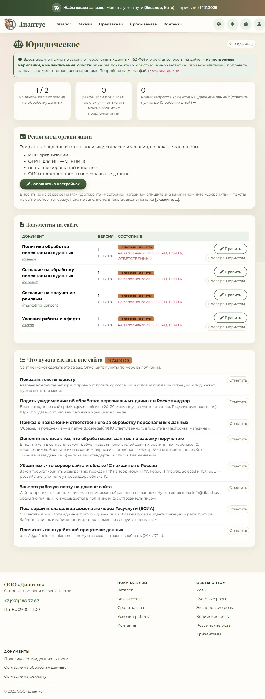

На странице: сколько клиентов дали согласие, сколько разрешили рекламу, сколько запросов на удаление данных ждут ответа (по закону — до 10 рабочих дней); какие реквизиты ещё не заполнены; таблица документов сайта (политика, согласия, условия) с кнопками **«Править»** и **«Проверен юристом»**; список дел **«Что нужно сделать вне сайта»**:

1. показать тексты юристу (часовая консультация обычно хватает);
2. подать уведомление об обработке персональных данных в Роскомнадзор (бесплатно, через сайт pd.rkn.gov.ru; готовые ответы на вопросы формы — `docs/legal/rkn_notification_guide.md`);
3. назначить приказом ответственного за персональные данные (образец — `docs/legal/order_responsible_pd.md`);
4. дополнить список тех, кто обрабатывает данные по вашему поручению;
5. убедиться, что сервер сайта и облако 1С находятся в России;
6. завести рабочую почту на домене сайта для обращений клиентов;
7. подтвердить владельца домена .ru через Госуслуги у регистратора (с 1 сентября 2026 года);
8. прочитать план действий при утечке данных (`docs/legal/incident_plan.md`).

Выполнив пункт, нажмите рядом **«Отметить»**.

> **Важно.** Тексты на сайте — качественные черновики, а не заключение юриста. Звонить и писать клиентам с предложениями можно **только** тем, у кого стоит согласие на рекламу (колонка «Согласие на рекламу» в таблице «Клиенты (Excel)»). Сообщения по заказам можно присылать всем.

## 3.10 Раз в неделю и раз в месяц

**Раз в неделю:** просмотреть журнал обращений 1С на странице «Интеграция» (нет ли ошибок); проверить, что в каталоге нет «зависших» товаров (нет остатка, но показан) и что не осталось «Новых» заказов старше суток; посмотреть заявки клиентов и рекламации.

**Раз в месяц:** убедиться, что ночные копии базы на месте (`sudo ls -lh /root/dianthus/backups`, подробности — `docs/ВЛАДЕЛЬЦУ.md`, раздел 10); проверить, что у уволенных сотрудников отозваны роли и отключены ключи обмена; попросить программиста запустить проверку сайта (раздел 3.11).

## 3.11 Поиск в интернете и качество сайта

* Состояние сайта «по оценкам» и список того, что ещё можно улучшить, — в файле `docs/ДО_100_ИЗ_100.md`: там отдельно то, что может сделать только владелец (фото товаров, регистрация в Яндекс Вебмастере и Яндекс Бизнесе, счётчик Метрики), и то, что сделано.
* **Проверка сайта одной командой:** `python scripts/site_audit.py https://dianthus-opt.ru` (только чтение): она проверяет заголовки, описания, картинки, разметку, скорость кэширования и доступность. Серьёзные замечания помечены **[!]**, мелкие — **[~]**.
* Разделы каталога «Розы оптом», «Хризантемы оптом» и другие (адреса вида dianthus-opt.ru/optom/rozy) создаются сами из того, что есть в наличии, и нужны для поиска в Яндексе и Google: ничего вручную делать не нужно.

## 3.12 Копии и обновления

Каждую ночь в 03:15 сервер сам делает копию базы и фото (хранятся 14 дней). Эти копии лежат на том же сервере, поэтому настройте копию «на сторону» (`BACKUP_REMOTE`, `docs/GUIDE_FROM_SCRATCH.md`, раздел 15). Обновление сайта делает программист по инструкции из `docs/ВЛАДЕЛЬЦУ.md`, раздел 10.

> **Важно.** Никогда не выполняйте на сервере `docker compose down -v` (стирает базу) и не правьте файлы на сервере вручную.

# Часть 4. Оператору 1С

Эта часть — для человека, который работает в 1С («Азалия New», база «Цветы») и передаёт данные на сайт. Программировать не нужно: всё делается кнопками в специальном окне — **обработке «Обмен 1С с сайтом Диантус»**. Подробности для программиста — `docs/1C_ПОШАГОВО.md` и `docs/ПАМЯТКА_СОТРУДНИКАМ.md`.

## 4.1 Главное правило

**Всё про товар — что есть, сколько, по какой цене, откуда, сколько штук в пачке — ведётся в 1С.** Сайт сам ничего не считает: он получает данные из 1С. Поэтому цифры на сайте руками не правим: правим в 1С и отправляем снова.

Что куда идёт:

* **Из 1С на сайт:** товары, цены, остатки, поставки (инвойсы), страны, размеры пачек, фото.
* **С сайта в 1С:** заказы клиентов.
* **Из 1С обратно на сайт:** статус заказа (подтверждён, отправлен, отменён).

## 4.2 Что важно заполнить в 1С, чтобы на сайте всё было верно

1. **Инвойс (приход) — проведён или нет.** Проведённый — товар лежит на складе и виден в каталоге. Непроведённый — «в пути»: клиенты смогут сделать **предзаказ**. Непроведённый инвойс старше 21 дня на сайт не передаётся.
2. **«В пачке» в строке инвойса** (колонка «Колво»). Клиенты покупают целыми пачками, и сайт берёт размер пачки отсюда. Если не заполнено, сайт угадывает по группе и виду товара, а в отчёте предупреждает.
3. **Страна — группа в дереве номенклатуры.** Сайт определяет страну по **ближайшей группе-стране** вверх по дереву: «Срезанные цветы → КЕНИЯ → Ultra Flo → товар». Поэтому товар нужно класть в **правильную группу-страну** (КЕНИЯ, ЭКВАДОР, ГОЛЛАНДИЯ, РОССИЯ…). Если группы-страны нет, берётся поле «Страна происхождения» в карточке, а затем подсказки по названию (например, «РФ»). Если определить не удалось — страна на сайте остаётся **пустой** (лучше пусто, чем неверно).
4. **Цена.** Строка инвойса без цены на сайт не попадёт: отчёт покажет её в списке ошибок.

## 4.3 Как открыть обработку

1. В 1С откройте меню **«Файл» → «Открыть…»** и выберите файл **`ОбменССайтом.epf`** на рабочем столе компьютера с 1С (он есть и в списке последних файлов меню «Файл»).
2. Если 1С спросит «Разрешить открывать данный файл?» — нажмите **«Да»**.
3. Появится окно со списком пунктов и номером версии в заголовке. Выберите нужный пункт двойным щелчком мыши (или стрелками и клавишей Enter).
4. **Читайте ответ до конца.** Это окно с текстом: что отправлено, сколько создано, есть ли ошибки. Закрыв его, вы вернётесь к списку пунктов.

> **Важно.** После закрытия окна список пунктов открывается заново, и **выделенным оказывается пункт 2 «Первая настройка»**. Не нажимайте Enter вслепую: сначала посмотрите на экран и выберите нужный пункт. Пункт 2 меняет настройки подключения.

## 4.4 Пришла машина или изменились цены: передать товар на сайт

Всегда по порядку, и каждый раз читайте ответ:

1. **Пункт 6 «Инвойсы (поставки): показать»** — что именно уйдёт на сайт. Ничего не отправляется. Внизу отчёта есть списки «ПРОВЕРЬТЕ…» (например, размер пачки или страна, которые программа угадала): впишите «В пачке» в инвойс и поправьте группу/карточку товара.
2. **Пункт 7 «Инвойсы (поставки): проверка на сайте»** — сайт «примеряет» данные и пишет, что изменилось бы. **Ничего не сохраняется** (в ответе слово «ПРОВЕРКА»).
3. **Пункт 8 «Инвойсы (поставки): ОТПРАВИТЬ на сайт»** — настоящая отправка. Если в ответе **«ошибок: 0»**, готово.
4. Есть ошибки (например, нет цены) — исправьте в 1С и повторите **6 → 7 → 8**.

Проверка результата: откройте на сайте каталог — под заголовком должно быть написано «Цены обновлены сегодня в …». Сверьте два-три товара с 1С.

> **Важно.** **Пункты 3, 4, 5 («Каталог „без поставки“») не используйте никогда:** товары задвоятся на сайте. Рабочий путь — только пункты 6 → 7 → 8.

## 4.5 Заказ с сайта: как перенести в 1С

Сейчас документы по заказам с сайта создаёт человек (автоматическое создание подготовлено, но ещё не включено — раздел 4.6).

1. Нажмите **пункт 9 «Заказы с сайта: показать новые»**: список новых заказов с номерами вида **САЙТ-57**: клиент, состав, дата, способ получения.
2. Создайте в 1С документ **так же, как обычно по звонку клиента** (у вас это «Счёт на оплату», затем накладная) и **зарезервируйте товар**. В комментарии напишите **САЙТ-57**: так вы не создадите документ дважды.
3. Нажмите **пункт 10**: программа спросит по каждому заказу, создан ли документ и зарезервирован ли товар. Отвечайте **«Да» только если документ уже создан.** Номер документа 1С можно ввести.
4. Нажмите **пункт 13** и отправьте статус **«Подтверждён»**: клиент увидит, что заказ принят.
5. Дальше по мере работы — **«В работе» → «Отправлен» → «Выполнен»** (тоже пункт 13).
6. **Отмена:** сначала отмените документ в 1С, затем отправьте статус **«Отменён»** пунктом 13: товар вернётся на сайт.

> **Важно.** Не оставляйте новый заказ неподтверждённым надолго: сайт «держит» его количество, и остаток покажется меньше, чем есть на самом деле.

## 4.6 Автозаказы: что подготовлено и когда включится

Для будущего, когда будет проверено, написаны пункты **16–19**: программа сама создаёт в 1С **непроведённую** «Расходную накладную» по заказу сайта (по образцу последней проведённой), находит клиента по ИНН, берёт товары по их коду в 1С и ставит в «НомерЗаказа» значение «САЙТ-N». Статусы идут обратно на сайт сами: непроведена → «Подтверждён», проведена → «Отправлен», помечена на удаление → «Отменён» («Выполнен» ставится вручную).

* **Пункты 16 и 19 безопасны:** они ничего не записывают (пробная сборка и самопроверка на выдуманном заказе).
* **Пункт 17 создаёт документы** и на боевой базе «Цветы» **запрещён**: он работает только в базах, перечисленных в настройке `orders_bases`. Сначала проверка на **копии базы-черновике** (инструкция для администратора — `docs/АВТОЗАКАЗЫ_1С.md`, раздел 4), и только после приёмки владелец решает о включении.
* **Пункт 18** отправляет на сайт статусы документов «САЙТ-N».

## 4.7 Фото товаров

Фото можно загрузить на сайт прямо из 1С:

1. Положите фото в папку **`Документы\Dianthus1C\photos`** на компьютере 1С. **Имя файла = название товара в 1С** (например, `Мондиал 60 Tessa.jpg`). Второе фото того же товара — с добавкой `#2`: `Мондиал 60 Tessa #2.jpg`.
2. Нажмите **пункт 20** — проверка: что нашлось и с каким товаром сопоставлено. На сайте ничего не сохраняется.
3. Если всё верно — **пункт 21**: фото уходят на сайт.

Съёмка: пачка на светлом фоне, при дневном свете, фото целиком.

## 4.8 Все пункты меню

| № | Пункт | Что делает | Когда нажимать |
|---|---|---|---|
| 1 | Проверить связь с сайтом | Проверяет, что сайт отвечает и ключ принят | После настройки; когда «что-то не так» |
| 2 | Первая настройка | Спрашивает адрес сайта, ключ, группу, склад, тип цен; записывает в `settings.ini` | Один раз; потом — только если сменился ключ |
| 3, 4, 5 | Каталог «без поставки» | Отдельный путь без инвойса | **Никогда** (задвоит товары) |
| 6 | Инвойсы: показать | Что уйдёт на сайт; **ничего не отправляет** | Перед каждой отправкой |
| 7 | Инвойсы: проверка на сайте | Сайт «примеряет» данные; **ничего не сохраняет** | Перед отправкой |
| 8 | Инвойсы: ОТПРАВИТЬ | Настоящая отправка: товары, цены, остатки, страны, пачки | Когда 6 и 7 без ошибок |
| 9 | Заказы с сайта: показать новые | Список новых заказов («САЙТ-57») | Несколько раз в день |
| 10 | Подтвердить создание и резерв | По каждому заказу: документ создан и товар зарезервирован? | Только после создания документа |
| 11 | Описание базы | Служебный отчёт для программиста | По просьбе программиста |
| 12 | Настройки и автообмен | Показывает настройки; включает и выключает отправку по расписанию | Один раз, когда решили включить автообмен |
| 13 | Статус заказа на сайт | Вручную: «Подтверждён», «В работе», «Отправлен», «Выполнен», «Отменён» | По ходу работы с заказом |
| 14 | Сверка | Печатает **все** строки инвойсов: поставщик, организация, валюта, страна и пачка (и откуда они взялись) | Когда нужно проверить данные глазами |
| 15 | Сведения о базе и образцы документов продаж | Только чтение, для программиста | Редко |
| 16 | Автозаказы: пробная сборка | Показывает накладные, которые были бы созданы; **ничего не записывает** | Перед приёмкой автозаказов |
| 17 | Автозаказы: СОЗДАТЬ накладные | Создаёт документы; только в базах из `orders_bases` | **Не на боевой базе** |
| 18 | Автозаказы: статусы на сайт | Отправляет статусы документов «САЙТ-N» | После включения автозаказов |
| 19 | Автозаказы: самопроверка | Прогон на выдуманном заказе; **ничего не записывает** | Для проверки |
| 20 | Фото: проверка | Что нашлось в папке фото; ничего не сохраняется | Перед пунктом 21 |
| 21 | Фото: ОТПРАВИТЬ | Загружает фото на сайт | Когда 20 в порядке |

**Автообмен.** Если включена отправка по расписанию (пункт 12 + задача Windows), пункты 6–8 выполняются сами. Оператору остаётся смотреть зелёную плашку на странице «Интеграция с 1С» в админке сайта и списки «ПРОВЕРЬТЕ…» из пункта 6.

## 4.9 Чего нельзя

* Менять остатки и цены **на сайте** вручную: они перезапишутся данными из 1С.
* Нажимать пункты **3, 4, 5** и пункт **17** на боевой базе.
* Отвечать «Да» в пункте **10**, пока документ в 1С не создан.
* Присылать кому-либо **ключ** обмена или файл **`settings.ini`** (в нём ключ открытым текстом).
* Нажимать Enter не глядя: после закрытия окна выделяется пункт 2.

## 4.10 Если что-то не так

| Что видите | Что делать |
|---|---|
| «ПРОВЕРКА, ничего не сохранено» | Это только проверка. Чтобы отправить по-настоящему — пункт **8** |
| На сайте нет товара, хотя в 1С он есть | Инвойс не проведён и старше 21 дня, нет цены или остаток меньше одной пачки. Исправьте и повторите **6 → 7 → 8** |
| Страна или пачка на сайте «не те» | Проверьте группу-страну товара в дереве номенклатуры и «В пачке» в инвойсе, затем **6 → 7 → 8** |
| Товар на сайте показан дважды | Его отправляли двумя способами (пункты 5 и 8). Не отправляйте ничего вслепую, позвоните владельцу |
| «401» или «неверный ключ» | Ключ отключён или набран с ошибкой: владелец создаёт новый («Интеграция с 1С» в админке), вы вводите его в пункте **2** |
| Заказ снова пришёл в пункте 9 | Он уже есть в 1С: найдите документ по «САЙТ-…», второй не создавайте, нажмите **10** |
| Сайт не открывается | Сообщите владельцу; клиентам отвечайте по телефону |

# Часть 5. Склад

Склад собирает заказы по **листу сборки**. Цифры на сайте склад не правит и статусы не меняет: это делает менеджер.

## 5.1 Как получить лист сборки

1. Менеджер (или вы, если у вас есть доступ) открывает админку: **шестерёнка → «Лист сборки»**. Это **сводный** лист на все активные заказы.
2. Чтобы собрать заказы на конкретный день, впишите дату в поле **«Только заказы на дату»** и нажмите **«Показать»**.
3. Нажмите **«Печать»** и распечатайте.
4. Лист по одному заказу — кнопка **«Лист сборки»** на странице этого заказа.

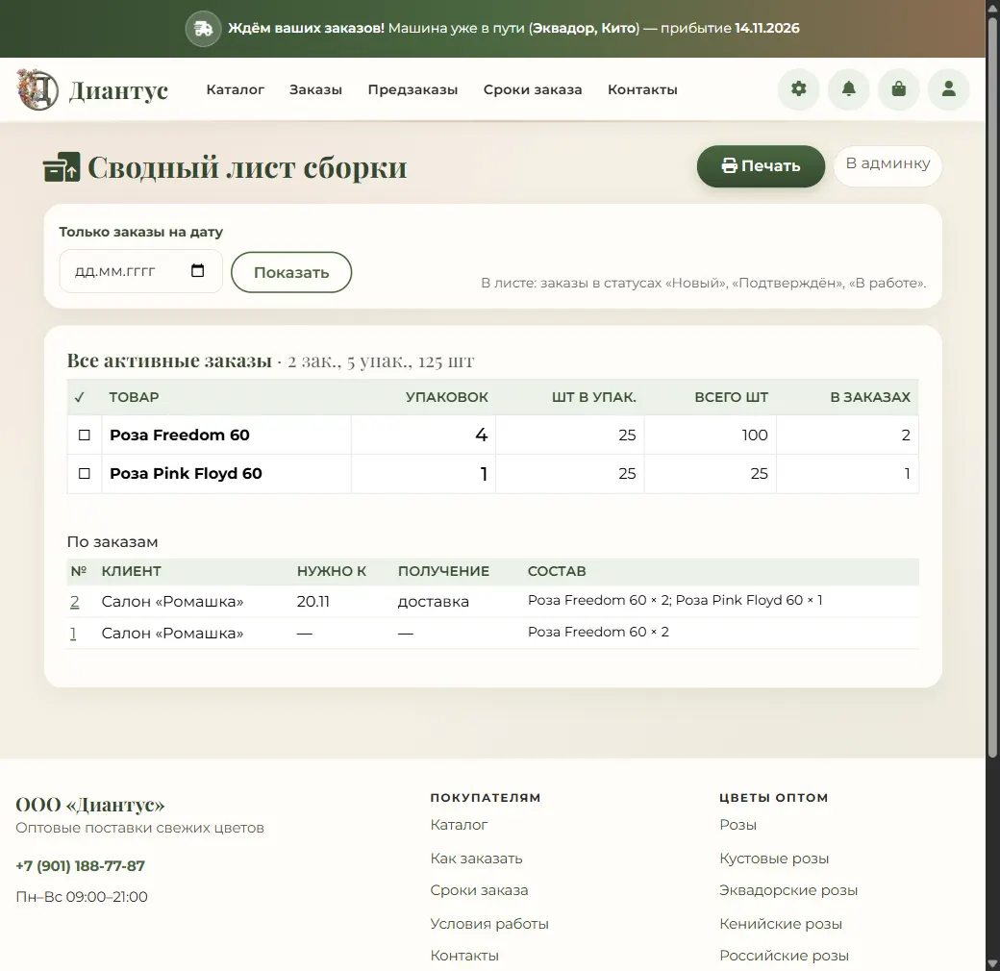

## 5.2 Как читать лист

Вверху написано, сколько заказов, упаковок и штук в листе. В таблице **«Все активные заказы»**:

* **✓** — квадратик: отмечайте ручкой, когда собрали позицию;
* **Товар** — название;
* **Упаковок** — **сколько пачек** достать (главное число, оно крупнее остальных);
* **Шт в упак.** — сколько штук в одной пачке;
* **Всего шт** — упаковки × штук в упаковке;
* **В заказах** — в скольких заказах встречается товар.

Ниже таблица **«По заказам»**: номер заказа, клиент, «Нужно к» (дата), способ получения (самовывоз или доставка) и состав. В лист попадают заказы со статусами «Новый», «Подтверждён» и «В работе».

## 5.3 Порядок сборки

1. Достаньте со склада нужное количество упаковок по сводной таблице, отмечая галочки.
2. Разложите собранное по заказам (таблица «По заказам»).
3. Если чего-то не хватает, пачка повреждена или цветы нехорошие — **сразу скажите менеджеру**, не меняйте и не пропускайте позицию сами.
4. Отдайте собранный заказ на отправку или выдайте при самовывозе. Менеджер или оператор 1С поставит статус «Отправлен».

# Часть 6. Если что-то пошло не так

## 6.1 Покупателю

| Что случилось | Что делать |
|---|---|
| Не могу войти | Проверьте, что вас **одобрили** (после регистрации нужна проверка менеджером). Забыли пароль — «Забыли пароль?». После нескольких ошибок вход закрывается на 10 минут |
| Письма не приходят | Загляните в «Спам». Письма — не единственный путь: статус заказа виден в «Мои заказы» и в уведомлениях на сайте |
| Не вижу цен | Цены открываются после регистрации и одобрения. Войдите в свой аккаунт |
| Нельзя оформить заказ | Чего-то уже нет в наличии или осталось меньше минимума: сайт напишет об этом. Уменьшите количество или уберите позицию. Если не получается — позвоните менеджеру |
| Заказал не то | Позвоните менеджеру сразу: пока заказ «Новый», его быстро отменят, и вы оформите верный |
| Цветы пришли с браком | Раздел 1.14: «Мои заказы» → «Сообщить о проблеме», лучше в течение суток, с фото |
| Сайт не открывается | Попробуйте через минуту и с другого интернета. Не помогло — позвоните менеджеру |

## 6.2 Менеджеру

| Что случилось | Что делать |
|---|---|
| Клиент не может войти | Раздел 3.4: проверьте, что одобрен; пусть воспользуется «Забыли пароль?»; в крайнем случае владелец сбрасывает пароль |
| Заказ оформился дважды | Такого быть не должно (есть защита от двойного нажатия). Если случилось: лишний заказ — статус «Отменён», товар вернётся |
| Не нашли заказ | Поищите по номеру, названию компании или телефону в строке поиска; проверьте фильтр статуса («Все») |
| Клиент хочет изменить заказ | В админке состав заказа не редактируется. Договоритесь с клиентом по телефону, запишите договорённость в «Заметку сотрудников», а изменение сделайте так: старый заказ — «Отменён» (товар вернётся на склад), клиент оформляет новый. Если документ в 1С уже создан, его исправляет оператор 1С |
| Подозрительная заявка | Не одобряйте, сообщите владельцу |

## 6.3 Оператору 1С

См. таблицу в разделе 4.10.

## 6.4 Владельцу

| Что случилось | Что делать |
|---|---|
| Плашка «Интеграция» красная | Прочитайте причину в плашке и в журнале ниже: чаще всего ключ отключён или неверный формат данных |
| Плашка жёлтая, в каталоге вчерашняя дата | 1С давно не обращалась: оператор не отправлял данные или остановился автообмен (раздел 4.4) |
| Нужно срочно отключить подрядчика | «Интеграция с 1С» → «Отключить» у его ключа |
| Письма с сайта не уходят | Не настроена почта (раздел 8 в `docs/ВЛАДЕЛЬЦУ.md`); сайт работает и без почты, но уведомления не придут |
| Забыли пароль администратора | Выполняется на сервере: `docs/ВЛАДЕЛЬЦУ.md`, раздел 9 |
| Сайт не открывается | `docs/ВЛАДЕЛЬЦУ.md`, раздел 9; программисту пришлите вывод команд, которые там указаны |

> **Важно.** Во всех случаях, когда не уверены, — **остановитесь и позвоните**, а не нажимайте кнопки наугад. Почти всё, что есть на сайте и в обработке, можно исправить, если не торопиться.

# Приложение А. Адреса страниц сайта

| Адрес | Что там |
|---|---|
| dianthus-opt.ru | Главная страница |
| dianthus-opt.ru/catalog | Каталог |
| dianthus-opt.ru/optom/rozy | Разделы каталога («Розы оптом», «Хризантемы оптом» и др.) |
| dianthus-opt.ru/help | «Как заказать»: инструкция и частые вопросы |
| dianthus-opt.ru/deadlines | Сроки заказа |
| dianthus-opt.ru/contacts | Контакты |
| dianthus-opt.ru/register, /login | Регистрация, вход |
| dianthus-opt.ru/cart, /orders, /preorders | Корзина, заказы, предзаказы |
| dianthus-opt.ru/claims | Обращения по качеству |
| dianthus-opt.ru/profile | Профиль |
| dianthus-opt.ru/terms, /privacy | Условия работы, политика обработки персональных данных |
| dianthus-opt.ru/admin | Админка (сотрудникам) |
| dianthus-opt.ru/admin/picking | Сводный лист сборки |
| dianthus-opt.ru/admin/settings | Настройки магазина (владелец) |
| dianthus-opt.ru/admin/integration | Интеграция с 1С (владелец) |
| dianthus-opt.ru/admin/legal | Юридическое (владелец) |

# Приложение Б. Журнал «Реализации товаров и услуг» в 1С: как выглядит и как настроить колонки

Это справка для оператора 1С и бухгалтерии. Она нужна, чтобы в журнале сразу было видно главное, а не горизонтальная простыня из двадцати колонок.

## Б.1 Как журнал выглядит «по умолчанию»

В журнал «Реализации товаров и услуг» попадают **и накладные, и счета на оплату**: у них разный «Вид накладной» («Расходная накладная» и «Счет на оплату») и номера (`д-001812`, `Сч-04149`). Документы, помеченные на удаление, отмечены в первой колонке красным крестиком; часть строк подсвечена цветом (цветная подсветка настроена в конфигурации). Сверху — командная панель «Действия», кнопки добавления, копирования, изменения, поиск по номеру, отбор, кнопки «Ввести накладную на основании счета» и «Ввести счет на основании накладной». Внизу — отбор по клиенту, по пользователю и по статусу проведения.

Колонки идут слева направо в таком порядке:

| № | Колонка | Что в ней | Нужна ли каждый день |
|---|---|---|---|
| 1 | **УУ** | галочка: документ проведён по управленческому учёту | да (показывает, проведён ли) |
| 2–4 | БУ, НУ, бух | то же по бухгалтерскому и налоговому учёту | нет (нужна только бухгалтеру) |
| 5 | **Дата** | дата и время документа | да |
| 6 | **Номер** | номер документа | да |
| 7 | **Вид накладной** | «Расходная накладная» или «Счет на оплату» | да, чтобы не путать |
| 8 | Подразделение | у вас везде «Азалия» | нет (одно и то же значение) |
| 9 | **Сумма** | сумма документа | да |
| 10 | **Контрагент** | клиент | да |
| 11 | Документ основание | например, счёт, на основании которого создана накладная | иногда |
| 12 | Склад | у вас почти везде «Главный» | редко |
| 13 | Организация | «Диантус ООО» или «ООО "ДИАНТУС"» | иногда |
| 14 | Ответственный | кто оформил: «Кладовщик1», «Директор», «Менеджер» | да |
| 15 | **Комментарий** | заметки: «Отправлено», «САЙТ-57», «Не отправлено» | да, это главное поле |
| 16 | Договор контрагента | везде «Договор покупателя» | нет |
| 17 | Торговое направление | «Срезанные цветы» / «Растения» | иногда |
| 18 | Ставка НДС | «Без НДС» | нет |
| 19–21 | Счет-фактура, Эквайринг, Начальный контрагент | в основном пусто | нет |

## Б.2 Какой порядок удобнее

Принцип: **слева — то, что нужно прочитать, не прокручивая; справа — редкое; одинаковое во всех строках — убрать совсем.**

Рекомендуемый порядок колонок журнала:

1. **УУ**
2. **Дата**
3. **Номер**
4. **Вид накладной**
5. **Контрагент**
6. **Сумма**
7. **Комментарий** (там «САЙТ-N», «отправлено»)
8. **Ответственный**
9. Документ основание
10. Склад
11. Торговое направление
12. Организация

**Скрыть** (галочку снять): БУ, НУ, бух (бухгалтеру оставить), Подразделение, Договор контрагента, Ставка НДС, Счет-фактура, Эквайринг, Начальный контрагент.

Почему так: менеджер ищет по дате, номеру, клиенту и сумме, а смотрит в комментарий («отправлено», «САЙТ-57»); колонки «Подразделение», «Договор» и «Ставка НДС» во всех строках одинаковые, они только занимают место.

## Б.3 Как это настроить: шаг за шагом

Настройка **личная**: она сохраняется для вашего пользователя 1С и не меняет вид у коллег.

1. Откройте журнал «Реализации товаров и услуг».
2. Нажмите кнопку **«Действия»** (слева на командной панели) и выберите **«Настройка списка…»**. Откроется окно с вкладками **«Колонки»** и **«Прочее»**.
3. В списке колонок стоят **галочки**: снимите ту, которую нужно скрыть.
4. Чтобы поменять порядок: нажмите на название колонки и стрелками **▲ ▼** (вверху окна) переместите её. Колонка «Дата» должна стоять сразу после «УУ», «Номер» — следом и т. д. по списку выше.
5. Нажмите **«ОК»** (или «Применить», чтобы посмотреть и продолжить).
6. Не понравилось — в том же окне кнопка **«Стандартная настройка»** возвращает всё как было.

> **Важно.** Настройка действует только для вас. Чтобы изменить вид для **всех** сотрудников сразу, нужен программист (это правка в Конфигураторе). Для начала достаточно, чтобы каждый настроил свой список за пять минут.

## Б.4 Таблица товаров в документе «Расходная накладная»

Внутри документа таблица товаров по умолчанию тоже длинная: **№, Цена расчётная, Подразделение, Вид товара, Номенклатура, Е. (значок), Остаток текущий, Количество, Цена, % Руч., % авт. скидок, Цена закупочная, Сумма, Характеристика, Артикул, С., Ед., К., Мест, %, %н.** Строки, где количество больше текущего остатка, выделены красным.

Рекомендуемый порядок:

1. **№**
2. **Номенклатура**
3. **Вид товара**
4. **Количество**
5. **Ед.**
6. **Цена**
7. **% Руч.** (ручная скидка)
8. **Сумма**
9. **Остаток текущий** (чтобы видеть, хватает ли)
10. Артикул

**Скрыть:** Цена расчётная, Подразделение, Цена закупочная (особенно если документ смотрят при клиенте), Характеристика, С., К., Мест, %, %н.

Как настроить: **щёлкните правой кнопкой мыши** по таблице товаров и выберите **«Настройка списка…»** (последний пункт меню). Дальше всё так же, как в Б.3: галочки скрывают колонки, стрелки ▲ ▼ меняют порядок, «Стандартная настройка» возвращает всё как было.

<!-- КОНЕЦ-ДОКУМЕНТА -->
